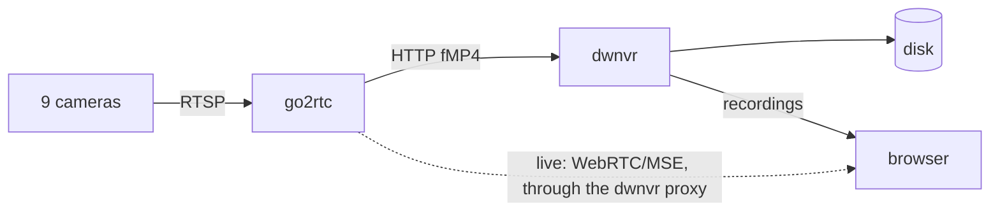

# dwnvr <!-- omit in toc -->

**English** · [Português (Brasil)](README.pt-BR.md)

[](https://github.com/mhagnumdw/dwnvr/actions/workflows/ci.yml)
[](https://app.codecov.io/gh/mhagnumdw/dwnvr)
[](https://github.com/mhagnumdw/dwnvr/actions/workflows/github-code-scanning/codeql)
[](https://github.com/mhagnumdw/dwnvr/actions/workflows/dependabot/dependabot-updates)
[](https://github.com/mhagnumdw/dwnvr/releases)

[](go.mod)


A continuous-recording NVR **designed for extremely limited hardware**. It is
not built for any specific device.

dwnvr has been tested throughout its development on an Orange Pi Zero 3 (4
Cortex-A53 cores, 1.5 GB RAM), recording 9 Yoosee cameras 24/7.

**No video transcoding. No database. No video decoding to find motion.**

Measured on that Orange Pi Zero 3 with all 9 cameras recording at once:

| | CPU | RAM |
| --- | --- | --- |
| dwnvr | **5% of 1 core** (1% of the 4) | **18 MB** |
| go2rtc | 10% of 1 core | 89 MB |

With the [object detector](#motion-and-object-detection) on, which is
optional, on all 9 cameras at sensitivity level 5, the highest:

| | CPU | RAM |
| --- | --- | --- |
| dwnvr | 5% of 1 core | 29 MB |
| go2rtc | 9% of 1 core | 80 MB |
| dwnvr-detect | 157% of 1 core (39% of the 4) | 229 MB, peaking at 246 MB |

With detection off, dwnvr costs the same as a build without it.

> **HEADS UP:** this project is entirely vibe coded, and it's my first project
> built that way. Besides solving a need of my own, which I believe many other
> people share, I wanted to find out what developing fully in this style would
> be like.
>
> Vibe coded as it is, the project was born focused on extreme performance,
> very low CPU and memory use, ultra-fast response times, and a UI that is
> fast, light, reactive and responsive, with great usability on mobile
> (browser) and desktop (browser). Part of that was a necessity, given the
> real hardware I used and still use, an Orange Pi Zero 3, and all of it shows
> in my tests and in my daily use. I tried several other options, and none
> came close to these results, not to mention a range of other problems and
> annoyances.

- [What you need](#what-you-need)
- [Try it in a few minutes](#try-it-in-a-few-minutes)
- [Installing for real](#installing-for-real)
- [Motion and object detection](#motion-and-object-detection)
- [Updating](#updating)
- [Remote access](#remote-access)
- [HTTPS](#https)
- [The UI as an app, on phone and computer](#the-ui-as-an-app-on-phone-and-computer)
- [Special cases](#special-cases)
- [How it works](#how-it-works)
- [Configuration](#configuration)
- [Documentation](#documentation)
- [Development](#development)
  - [Running from source](#running-from-source)
  - [Technologies](#technologies)
  - [Project structure](#project-structure)
  - [Build](#build)
  - [Tests](#tests)
  - [Lint](#lint)
  - [Release](#release)

## What you need

- Linux on **amd64** or **arm64** (Orange Pi, Raspberry Pi, any PC);
- **Docker with Compose v2**, or Podman.

That's all. Nothing is compiled or installed on your machine: dwnvr comes
ready to run. You don't even need a camera to try it, because the quick test
brings eight test cameras.

## Try it in a few minutes

> If you already want to install it for good, with your own cameras, skip to
[installing for real](#installing-for-real).

Starts dwnvr with eight test cameras: five synthetic ones, drawn by ffmpeg,
and three public streams from the internet, with real street footage.
Everything stays inside the clone's directory, and deleting it undoes it all.

```sh
git clone https://github.com/mhagnumdw/dwnvr && cd dwnvr

# These must exist first: if Docker creates them, they're owned by root and
# the container - which doesn't run as root - can't write inside them.
mkdir -p config/dwnvr config/go2rtc storage

# The dwnvr and go2rtc configuration, with the test cameras.
cp dwnvr.example.yaml  config/dwnvr/dwnvr.yaml
cp go2rtc.example.yaml config/go2rtc/go2rtc.yaml

# The container records as your user, so the files on disk are yours, and in
# your machine's time zone, so the timeline turns the day at the right hour.
printf 'DWNVR_UID=%s\nDWNVR_GID=%s\nTZ=%s\n' \
  "$(id -u)" "$(id -g)" "$(timedatectl show -p Timezone --value)" > .env

docker compose up
```

> With [Podman](#with-podman-) instead of Docker, the last command is
`PODMAN_USERNS=keep-id podman-compose --in-pod false up`.

When the log says `dwnvr no ar`, open <http://localhost:8080>:

1. on the **Câmeras** (Cameras) tab, click `cam_teste1`, listed under
   *Disponíveis no go2rtc* (Available in go2rtc) along with the other seven -
   `cam_teste5` has audio, and `traffic`, `roadcam` and `accident` are real
   street footage;
2. the **Ao vivo** (Live) tab already shows the camera;
3. in ~30s the first stretch closes and shows up on the **Gravações**
   (Recordings) tab.

There's no login screen: it stays off until you set a username and password.
That's on purpose, so the quick test doesn't get stuck on a password, and it
applies only to the quick test: in the [real installation](#installing-for-real),
turning the login on is one of the steps. While it's off, dwnvr warns about it
in the log.

> There's no **Detecções** (Detections) tab because the quick test doesn't
> start the object detector, and that's what brings the tab. To turn
> detection on, see [motion and object detection](#motion-and-object-detection).

To undo everything:

```sh
docker compose down
rm -rf config storage .env
```

> With [Podman](#with-podman-) instead of Docker, the first command is
`podman-compose --in-pod false down`.

## Installing for real

It's the same `docker-compose.yml` as the quick test, without editing a single
line of it: what changes is the `.env`, which says where things live on disk.
That's why the update's `git pull` never conflicts with your installation.

### 1. The code <!-- omit in toc -->

```sh
git clone https://github.com/mhagnumdw/dwnvr && cd dwnvr
```

The clone can live wherever you like: it only holds `docker-compose.yml` and
`.env`. The configuration and the recordings live in the directory from the
next step. If you already cloned for the quick test, undo the test and reuse
the same clone.

### 2. The directories <!-- omit in toc -->

Assuming a disk at `/mnt/storage` - replace it with yours on the first line of
the command block, run inside the clone:

```sh
# The installation directory, on your disk
DWNVR_DIR=/mnt/storage/dwnvr

sudo mkdir -p "$DWNVR_DIR"/{config/dwnvr,config/go2rtc,recordings}
sudo chown -R "$(id -u):$(id -g)" "$DWNVR_DIR"

cp dwnvr.example.yaml  "$DWNVR_DIR/config/dwnvr/dwnvr.yaml"
cp go2rtc.example.yaml "$DWNVR_DIR/config/go2rtc/go2rtc.yaml"

# The dwnvr login password and the camera passwords will sit in these files
# exactly as you write them: only your user reads and writes them, not your
# group and not anyone else.
chmod 600 "$DWNVR_DIR/config/dwnvr/dwnvr.yaml"
chmod 600 "$DWNVR_DIR/config/go2rtc/go2rtc.yaml"
```

It ends up like this:

```text
On the host                                                        In the container
/mnt/storage/dwnvr/
├── config/
│   ├── dwnvr/       dwnvr.yaml, cameras.json, .session-secret  →  /etc/dwnvr
│   └── go2rtc/      go2rtc.yaml: your cameras, with passwords  →  /config
└── recordings/      the recordings                             →  /storage
```

Create them **before** starting, for the same reason as in the quick test.
Each service has its own subfolder under `config/` on purpose: each container
sees only its own. The RTSP URLs, with username and password, aren't visible
to dwnvr, and the session secret and the dwnvr login password aren't visible
to go2rtc.

The `chmod 600` doesn't take access away from the containers: dwnvr runs as
your user, the `DWNVR_UID` from step 3, and go2rtc runs as root under Docker
and as your user under Podman. When go2rtc's web interface saves
`go2rtc.yaml`, the permission stays the same. If you installed before these
`chmod` lines were added here, run both now.

### 3. The `.env` <!-- omit in toc -->

Next to `docker-compose.yml`, in the same terminal as the previous step, which
already has `DWNVR_DIR`:

```sh
cat > .env <<EOF
# Where things live on the host
DWNVR_CONFIG_DIR=$DWNVR_DIR/config/dwnvr
DWNVR_STORAGE_DIR=$DWNVR_DIR/recordings
GO2RTC_CONFIG_DIR=$DWNVR_DIR/config/go2rtc

# The user the container records as
DWNVR_UID=$(id -u)
DWNVR_GID=$(id -g)

# Your machine's time zone, such as America/Fortaleza
TZ=$(timedatectl show -p Timezone --value)
EOF

# Check the result
cat .env
```

A wrong `DWNVR_UID` or `DWNVR_GID` makes the camera setup screen fail when it
saves `cameras.json`. `TZ` decides which day each recording belongs to: if
it's wrong, the timeline turns the day at the wrong hour.

### 4. Your cameras <!-- omit in toc -->

> **First:** dwnvr reads the stream straight from the camera, and many cameras
> ship with that turned off. Enable RTSP (or ONVIF) in the camera's web
> interface or app. It usually has its own username and password. If your
> camera has no RTSP, go2rtc accepts
> [other sources](https://github.com/AlexxIT/go2rtc#module-streams), such as
> RTMP, HTTP and vendor protocols.

In `go2rtc.yaml`, delete all the test cameras and add yours. The commented
block in the file has examples: high and low resolution, audio, the general
shape of an RTSP URL. Once started, they show up on their own on the
**Câmeras** tab, ready to add.

Changed the file with everything already running - a new camera, a removed
one, or just a different URL? go2rtc reads `go2rtc.yaml` only when it starts,
so it has to restart for the change to apply. The **Câmeras** tab warns when
it notices the difference and has a button to restart it;
`docker compose restart go2rtc` does the same. Meanwhile, the cameras stop
recording for a few seconds.

### 5. The login <!-- omit in toc -->

Fill in `server.username` and `server.password` in `dwnvr.yaml`. While both
are empty, anyone who opens the interface sees the recordings of every camera.

That's your account, the admin one. Everyone else in the house you create on
the **Usuários** (Users) tab: dwnvr generates a link valid for 10 minutes, and
each person sets their own password through it. Those who sign in this way see
the live view, the recordings and the detections; camera setup, users and the
server diagnostics stay with you alone. Forgot the password or lost the
phone: generate a new link for that person, and the old password stops
working right away. From the avatar, in the top corner, each person opens
**Minha conta** (My account), where they change their name, photo and, except
for you, password.

### 6. Start it <!-- omit in toc -->

```sh
docker compose up -d
```

> With [Podman](#with-podman-) instead of Docker:
`PODMAN_USERNS=keep-id podman-compose --in-pod false up -d`.

When `docker compose logs dwnvr` says `dwnvr no ar`, open
`http://<machine-ip>:8080` in the browser:

1. sign in with the username and password from step 5;
2. on the **Câmeras** tab, click a camera under *Disponíveis no go2rtc*;
3. set the name, the quota and anything else you want, and click **salvar**
   (save) - it starts recording right away.

Repeat step 2 for each camera.

## Motion and object detection

Optional, and off by default. The steps below assume an
[installation for real](#installing-for-real) already running. There are two
layers:

- **Motion** marks on the timeline the moments when something moved. It needs
  nothing besides dwnvr: turn it on per camera, on the **Câmeras** tab. It
  costs almost no CPU, because it doesn't decode video.
- **Objects** tells whether that motion was a person, a vehicle or an animal.
  It needs the `dwnvr-detect` container, and it costs real CPU and RAM - see
  the second table at the top.

> **What to expect from accuracy.** dwnvr was built for modest hardware, and
> all detection runs on the CPU, with no dedicated accelerator. So it doesn't
> have the accuracy of a system with specialized hardware: motion detection in
> particular may mark what doesn't matter and miss an event. Even so, object
> detection gets it right a lot, and it's impressive for what it delivers on
> such limited hardware. Specialized hardware, such as an NPU or a Coral, may
> come in the future.

### Turning on motion detection <!-- omit in toc -->

It's turned on camera by camera, and it's a requirement for the object
detector: the detector only looks at cameras with motion detection on.

1. on the **Câmeras** tab, click **editar** (edit) on the camera - or turn it
   on when adding it;
2. on the form's **Detecção** (Detection) tab, check **Marcar movimento na
   timeline** (Mark motion on the timeline);
3. pick the **Sensibilidade** (Sensitivity): the higher it is, the more motion
   it catches and the more marks per hour it makes - the screen shows how
   many. The default is 5;
4. leave **Mecanismo** (Method) at *estatístico (recomendado)* (statistical,
   recommended) and click **salvar**.

The result shows up a few seconds later on the **Gravações** tab: an amber
band on the timeline marks the moments of motion. With the object detector,
the timeline also gets the person, vehicle or animal icon, and the
**Detecções** tab appears, with all of them.

### Turning on the object detector <!-- omit in toc -->

In the clone's folder:

```sh
# The compose now starts the dwnvr-detect service as well
echo "COMPOSE_PROFILES=detect" >> .env
```

In `dwnvr.yaml`, uncomment:

```yaml
detector:
  url: http://dwnvr-detect:8480
```

And start it again. The `restart` makes dwnvr reread `dwnvr.yaml`, in case it
was already running:

```sh
docker compose up -d && docker compose restart dwnvr
```

> With [Podman](#with-podman-) instead of Docker:
>
> ```sh
> PODMAN_USERNS=keep-id podman-compose --in-pod false up -d \
>   && podman-compose --in-pod false restart dwnvr
> ```

The object detector uses half of the machine's cores, up to 4 threads, and
leaves the other half to recording. For a different number, put it in `.env`,
for example `DETECT_THREADS=2`, and run `up -d` again.

### Turning on the alert <!-- omit in toc -->

With the object detector on, each camera can warn when it detects, for
example, a person at the gate:

1. on the **Câmeras** tab, click **editar** on the camera;
2. if you want the alert to apply only to part of the image, draw that part on
   the **Áreas** (Areas) tab;
3. on the **Alerta** (Alert) tab, check **Avisar quando detectar** (Warn when
   detected), choose what triggers it (person, vehicle, animal) and where (the
   whole image or only the marked areas), and click **salvar**.

The alert goes to the dwnvr log and is flagged on the detection: on the
**Detecções** tab, the **só alertas** (alerts only) button shows only the ones
that alerted, with the area the object fell in. With the `alerts.email.to`
list and the `smtp` section of `dwnvr.yaml`, it also arrives by e-mail, with
the frame already showing the boxes and the areas and, with
`server.publicUrl`, a button that opens the recording at the moment of the
alert (see [`docs/configuration.md`](docs/configuration.md#e-mail-alerts));
the **Para onde vai** (Where it goes) block, at the end of the Alerta tab,
says whether it goes out by e-mail and to whom. And it warns about what
detection marks, which isn't every arrival: it's not an alarm. The limits are
in [`docs/detection.md`](docs/detection.md#the-alert).

## Updating

Updates dwnvr to the latest version - and, along with it, `dwnvr-detect`, if
it's on, and go2rtc. What changed in each version is in the
[releases](https://github.com/mhagnumdw/dwnvr/releases) and in
[`CHANGELOG.md`](CHANGELOG.md). In the clone's folder:

```sh
git pull && docker compose up -d --pull always
```

> With [Podman](#with-podman-) instead of Docker:
>
> ```sh
> git pull && PODMAN_USERNS=keep-id podman-compose --in-pod false up -d --pull-always
> ```

`git pull` brings the new `docker-compose.yml`, which points to the images of
its version; `--pull always` downloads those images and recreates only the
containers that changed. The configuration and the recordings stay where they
are: `dwnvr.yaml` and `go2rtc.yaml` are yours, and no update rewrites them. To
see whether a new option arrived, compare your `dwnvr.yaml` with the clone's
`dwnvr.example.yaml`.

If the pull fails, the command stops there and what's running keeps
recording.

A release that asks for action when updating says so at the top of its notes,
in **Action required on upgrade**. For 1.0.0, the steps are in
[`docs/upgrading.md`](docs/upgrading.md).

When a new version is out, the interface shows a `↑ vX.Y.Z` pill at the top,
which leads to the releases. The one asking is the browser, straight to
GitHub, at most once every 12 hours: the dwnvr server never reaches out to the
internet, and on a network without it the notice simply doesn't show up.

**Pinning or rolling back a version.** The image tag comes from
`DWNVR_VERSION` in `.env`, which overrides the version written in the compose.
To stay on a version, or go back to an earlier one, put its tag in `.env`,
such as `DWNVR_VERSION=v0.1.0`, and run the same command above; the
recordings and the configuration live in the volumes, outside the image. To
follow the releases again, delete the line from `.env`. With
`DWNVR_VERSION=main`, the installation follows every commit on `main`, before
it becomes a version: that's the testers' channel.

go2rtc also has a pinned version in the compose, the one tested with that
dwnvr version, and it changes only when the compose changes. To use another
one, put `GO2RTC_VERSION` in `.env`, such as `GO2RTC_VERSION=1.9.14`, with one
of the [go2rtc tags](https://hub.docker.com/r/alexxit/go2rtc/tags).

## Remote access

To open dwnvr away from home, from a phone or another computer, without
opening a port on the router or exposing the server to the internet, the way
is [Tailscale](https://tailscale.com): a VPN, free for personal use, which
also gives dwnvr an `https://` address with a valid certificate. It can also
give the family access, each person with their own account and only to dwnvr.

There's nothing to configure in dwnvr. The step by step, from the server to
each device, is in [`docs/remote-access.md`](docs/remote-access.md).

## HTTPS

dwnvr serves only `http://`. For `https://`, there are two ways:

- **at home and away**, through Tailscale:
  [`docs/remote-access.md`](docs/remote-access.md);
- **at home only**, without Tailscale:
  [`docs/https-local-network.md`](docs/https-local-network.md).

## The UI as an app, on phone and computer

This installs nothing on the server: it's the dwnvr UI, the one you open in
the browser, becoming an app on the viewer's device. It gets an icon on the
home screen and opens in its own window, without the browser's address bar.
That's what's called a PWA.

- **Android and computer:** in Chrome, the ⋮ menu > **Install app**. On the
  computer, also through the install icon in the address bar.
- **iPhone:** in Safari, share > **Add to Home Screen**. Not tested yet.

The browser only offers to install when the address is `https://` (see
[HTTPS](#https)). Through `http://<machine-ip>:8080` on the home network,
Chrome on Android creates only a shortcut, which opens in a regular tab.

## Special cases

### With Podman <!-- omit in toc -->

The same compose runs under `podman-compose`, as long as Podman maps your
user to itself inside the container:

```sh
PODMAN_USERNS=keep-id podman-compose --in-pod false up
```

Without `keep-id`, rootless Podman turns your UID into root inside the
container, and dwnvr, which runs as `DWNVR_UID`, can't read `.session-secret`
or write to `config/dwnvr/` and `storage/`. The `--in-pod false` is because
`PODMAN_USERNS` is ignored inside a pod. Both options stay out of
`docker-compose.yml` because Docker rejects `keep-id`.

To bring it down, `--in-pod false` is still needed. Without it,
`podman-compose` looks for a `pod_dwnvr` pod that was never created and ends
with `Error: no pod with name or ID pod_dwnvr found`:

```sh
podman-compose --in-pod false down
```

With SELinux on (Fedora, RHEL), Podman also blocks reading the volumes, and
the `:z` the compose already has on each one is what allows it. In that case,
the first start relabels every recording already on disk, which may take a
while if there are many.

### go2rtc already runs elsewhere <!-- omit in toc -->

If go2rtc already runs in another compose or directly on the host, this is the
only case where you edit `docker-compose.yml`:

1. delete the `go2rtc` service and the `depends_on: [go2rtc]` of `dwnvr`, and
   uncomment `extra_hosts`;
2. in `dwnvr.yaml`, change `go2rtc.url` to `http://host.docker.internal:1984`.

With the file edited, the update's `git pull` may conflict: put the edit
away with `git stash` before and bring it back with `git stash pop` after.

### Opening go2rtc to the network <!-- omit in toc -->

go2rtc's web interface (port 1984) and its RTSP (port 8554) are open only on
the server itself: `http://localhost:1984` works there, and not from another
machine. dwnvr doesn't need more than that, because it talks to go2rtc over
the compose network. And neither asks for a password by default: open to the
network, any device on your Wi-Fi could read go2rtc's configuration, with the
camera passwords, and watch the cameras without going through the dwnvr
login.

To use the interface from another machine only now and then, an ssh tunnel is
enough, without opening anything:

```sh
ssh -L 1984:localhost:1984 <user>@<machine-ip>
# and open http://localhost:1984 on your machine
```

To open it for good, as for an RTSP app on the phone, set the password first:

1. in `go2rtc.yaml`, `username` and `password` in the `api:` section, in
   `rtsp:` or in both - the comments of
   [`go2rtc.example.yaml`](go2rtc.example.yaml) show where;
2. if you set it in `api:`, the same in `go2rtc.username` and
   `go2rtc.password` of `dwnvr.yaml`. Without it, dwnvr can no longer reach
   go2rtc;
3. in `.env`, `GO2RTC_API_PORT=1984`, `GO2RTC_RTSP_PORT=8554` or both;
4. `docker compose up -d`, which recreates go2rtc with the new ports, and
   `docker compose restart dwnvr`, so it reads `dwnvr.yaml`.

The RTSP app then needs the username and password in the URL:
`rtsp://usuario:senha@<machine-ip>:8554/<stream>`.

### Checking the recordings outside the UI <!-- omit in toc -->

The recordings live in the `DWNVR_STORAGE_DIR` directory - in the quick test,
`./storage` -, owned by your user:

```sh
# the init, the NDJSON index and the segments
find storage -type f

# Any segment plays on its own, with no preprocessing and no init next to it
ffplay "$(find storage/cam_teste1/2* -name '*.mp4' | head -1)"
```

How to copy a stretch of a recording, and the rest of the day to day - logs,
a container without a shell -, is in [`docs/operations.md`](docs/operations.md).

## How it works



dwnvr consumes the fMP4 that **go2rtc already produces** (`/api/stream.mp4`)
and cuts it into keyframe-aligned segments. It never decodes, never remuxes
and never touches the media bytes - it only reads box headers to know where to
cut. That's where the 4% of a core comes from.

> A **segment** is a short video file - ~30s by default - that plays on its
> own. A day's recording isn't one giant file: it's a queue of segments, and
> that's why deleting the oldest one, jumping to a specific time or exporting
> a stretch costs almost nothing.

**go2rtc is out of scope.** Configuring it is up to whoever installs it;
dwnvr only discovers the existing streams through `/api/streams` and
recommends a configuration.

> dwnvr may configure go2rtc automatically some day, but not for now.

The reason behind each format decision is in
[`docs/architecture.md`](docs/architecture.md).

**Detection is optional**, and comes off. Turned on for a camera, it marks on
the timeline the moments of motion, computed from the size of the frames -
again without decoding anything. With the `dwnvr-detect` container, it also
tells whether it was a person, a vehicle or an animal. How it works and what
it costs, in [`docs/detection.md`](docs/detection.md).

## Configuration

Two files, on purpose:

- **`dwnvr.yaml`** - infrastructure, edited by hand, **never rewritten** by
  the application. See [`dwnvr.example.yaml`](dwnvr.example.yaml).
- **`cameras.json`** - the camera list, written by the setup screen.

They're separate because they have different life cycles: the infrastructure
is edited by hand and hardly ever changes; the camera list is written by the
application on every click. In a single file, dwnvr would have to rewrite,
several times a day, a file someone might have open in an editor at that very
moment - wiping out along the way the comments that person wrote. The way it
is, a bug in the setup screen or a power cut in the middle of it can't reach
the service's configuration.

Everything that is recording policy is **per camera**: which go2rtc stream to
use (high or low resolution), audio, quota, segment length, the inactivity
threshold and detection - on or off, the method and the sensitivity level,
from 1 to 5. Details, including the CPU and disk cost of each audio mode, in
[`docs/configuration.md`](docs/configuration.md).

The login limits the attempts from each address
(`server.loginAttemptsPerMinute`, on by default), so nobody can try passwords
endlessly. Details in
[`docs/configuration.md`](docs/configuration.md#login-attempt-limit).

The object detector is optional: a separate container, `dwnvr-detect`, set by
`detector.url` in `dwnvr.yaml`. Without it, detection marks only motion.

E-mail is optional too: with the `smtp` section of `dwnvr.yaml`, from any
provider, the set-password link goes straight to the person. Details, with
the Gmail step by step, in
[`docs/configuration.md`](docs/configuration.md#e-mail). The
`alerts.email.to` list, also optional, says who gets the detection alert by
e-mail (see [`docs/configuration.md`](docs/configuration.md#e-mail-alerts)).

## Documentation

| Document | What for |
| --- | --- |
| [`docs/operations.md`](docs/operations.md) | the day to day: files, copying a stretch of a recording, logs, a container without a shell |
| [`docs/configuration.md`](docs/configuration.md) | the two files, per-camera policy, retention, audio |
| [`docs/remote-access.md`](docs/remote-access.md) | `https://` from anywhere, the installable app and family access, without exposing the server |
| [`docs/https-local-network.md`](docs/https-local-network.md) | `https://` on the home network only, without Tailscale: Caddy and the CA on each device |
| [`docs/architecture.md`](docs/architecture.md) | the on-disk format and why it's that way |
| [`docs/detection.md`](docs/detection.md) | motion and object detection: the flow, the cost and the limits |
| [`docs/resilience.md`](docs/resilience.md) | power cuts and the go2rtc that goes silent without warning |
| [`docs/api.md`](docs/api.md) | the HTTP endpoint reference |
| [`docs/upgrading.md`](docs/upgrading.md) | the upgrade guide to 1.0.0 |
| [`web/README.md`](web/README.md) | developing the UI |
| [`docs/github.md`](docs/github.md) | what's turned on in GitHub, and the Dependabot PR |
| [`docs/README.md`](docs/README.md) | the full index, including the dated measurements |
| [`CHANGELOG.md`](CHANGELOG.md) | what changed in each version |

## Development

What follows is for those who will change the code. To use dwnvr, the
sections above are enough.

### Running from source

`docker-compose.yml` uses the published images. To run what's in your clone,
add `docker-compose.build.yml`, which builds both images with the local `:dev`
tag:

```sh
docker compose -f docker-compose.yml -f docker-compose.build.yml up --build
```

The first build takes a few minutes; the next ones reuse the cache.

### Technologies

| What | Where it fits |
| --- | --- |
| **Go 1.27** | The whole server. Standard library only, **no [cgo](https://pkg.go.dev/cmd/cgo)** - the binary is static, ~8 MB |
| **go2rtc** | The stream source: speaks RTSP to the cameras and delivers fMP4, WebRTC and MJPEG |
| **fMP4** (fragmented MP4) | The on-disk format. It's what go2rtc already produces, so recording is copying bytes |
| **NDJSON** | The recordings index, one file per camera per day, append-only |
| **Svelte 5 + TypeScript + Vite** | The UI, embedded in the binary with `go:embed` |
| **MSE** (Media Source Extensions) | The recordings player, written by hand so as not to load [hls.js](https://github.com/video-dev/hls.js/) |
| **Docker** | A multi-arch `FROM scratch` image, for `linux/arm64` and `linux/amd64` |
| **dwnvr-detect** (optional) | The object detector: Python, PyAV and onnxruntime running RF-DETR nano (Apache-2.0) at 512x288 in int8 |

The project's only Go dependency is `go.yaml.in/yaml/v3`. There's no
database, ORM, HTTP framework or ffmpeg - and that absence is the project, not
a missing step. What needs native code, decoding video and running a vision
model, lives outside the binary, in the optional `dwnvr-detect` container.

### Project structure

```text
├── cmd/
│   └── dwnvr/              the binary: reads the config, starts one recorder per camera, serves HTTP
├── internal/
│   ├── api/                HTTP server
│   │   ├── server.go       the routes and the role each one requires
│   │   ├── auth.go         per-person login and session, in a signed cookie (HMAC), stateless on the server
│   │   ├── address.go      the address of whoever made the request, behind a proxy or not, for the login limit
│   │   ├── users.go        the Users screen and the invite link
│   │   ├── email.go        the Diagnostics test e-mail and the pieces of the invite link by e-mail
│   │   ├── account.go      My account: one's own password, name and photo, and serving the photos
│   │   ├── drop.go         closes the live view and the session notice of someone removed or given a new link
│   │   ├── cameras.go      camera setup, matched against the go2rtc streams
│   │   ├── probe.go        finds out whether an idle stream carries audio, with a cache
│   │   ├── recordings.go   days, timeline, init, segments, thumbnail, HLS, export
│   │   ├── detections.go   the detections of every camera, paginated, and the frame of each one
│   │   ├── live.go         the go2rtc proxy, with the credential kept on the server
│   │   ├── diagnostics_server.go   the recording machine, for Diagnostics: temperature, memory, storage, go2rtc, detector
│   │   ├── diagnostics_process.go  dwnvr itself, for Diagnostics: CPU, memory, open files, UID
│   │   ├── web.go          serves the embedded SPA
│   │   └── dist/           the UI build, versioned (see web/README.md)
│   ├── alert/              when detection becomes an alert, the record and the contract of the delivery channels
│   ├── area/               the polygon over the image and the rules for "is the object inside?"
│   ├── buildinfo/          version, commit and date injected at build time
│   ├── config/             reading dwnvr.yaml (infra) and cameras.json (cameras)
│   ├── detect/             detection: from the size of the frames to the object mark
│   ├── email/              sends e-mail through the SMTP server of the smtp section, standard library only
│   ├── fmp4/               MP4 box reader - the heart of "no decoding"
│   │   ├── box.go          walks the boxes without touching media
│   │   ├── moov.go         reads the init segment (ftyp+moov) and its tracks
│   │   ├── fragment.go     reads moof+mdat and finds out which frames are keyframes
│   │   ├── rebase.go       rewrites tfdt so each segment starts from zero
│   │   ├── probe.go        init hash and probing of orphan segments
│   │   ├── sps.go          the real resolution from the H264/H265 SPS
│   │   └── fixinit.go      swaps the init's parameter sets for the ones in the stream
│   ├── go2rtc/             client for the go2rtc API and the fMP4 stream
│   ├── logbuf/             keeps the latest log warnings and errors in memory, for Diagnostics
│   ├── ratelimit/          the per-client request limit (GCRA) the login uses
│   ├── recorder/           one recorder per camera: cuts at keyframes and writes
│   ├── retention/          deletes the oldest when quota, age or disk run out
│   ├── store/              on-disk layout and NDJSON index
│   └── users/              users.json, each one's role and e-mail, the invite link, the password hash (PBKDF2, one account at a time), the photo and the last access
├── dwnvr-detect/           the object detector, optional, in a separate container (see dwnvr-detect/README.md)
├── web/                    Svelte 5 + TypeScript + Vite UI (see web/README.md)
├── docs/                   long-form documentation (see docs/README.md)
├── CHANGELOG.md            what changed in each version, generated at release
├── cliff.toml              the format of CHANGELOG.md and of each release's notes (git-cliff)
├── docker-compose.yml      dwnvr + go2rtc (+ dwnvr-detect, optional), the single file to start everything
├── Dockerfile              FROM scratch image, multi-arch
├── dwnvr.example.yaml      dwnvr configuration, field by field
├── go2rtc.example.yaml     go2rtc configuration, with the test cameras
└── Makefile                build, tests and deploy
```

<details>
<summary><b>Why the folders have these names</b></summary>

Some names above aren't this project's choice. Some are **Go community
convention** - you can ignore them and nothing breaks, it just looks odd to
readers. Others are **required by Go**: renaming them breaks the build.
Summary before the details:

| Path | What it is | If you rename it |
| --- | --- | --- |
| `cmd/` | community convention | builds the same, only surprises readers |
| `internal/` | **required by Go** | the package becomes importable by any project |
| `internal/api/dist/` | our choice, **imposed by `go:embed`** | the build breaks |
| `web/src/vendor/` | convention, and on the JavaScript side | nothing happens |
| `*_test.go` | **required by Go** | the file ends up in the final binary |

#### `cmd/` - community convention <!-- omit in toc -->

It's neither this project's invention nor a compiler requirement: it's the
habit of practically every sizable Go project - Kubernetes, Docker,
Prometheus, go2rtc itself.

The rule is simple: **each subdirectory of `cmd/` becomes a binary**, and it's
the only place `package main` lives. The subdirectory's name is the
executable's name - `cmd/dwnvr` produces `dwnvr`. There's only one folder here
because there's only one binary; a second executable would be a sibling
folder, with nothing else reorganized.

What the convention buys: `main` stays thin - it reads the configuration,
wires the pieces and gets out of the way, with all the logic in testable
packages under `internal/`; `go build ./cmd/dwnvr` is unambiguous, with no
hunting for the file that has `main`; and adding a second binary reorganizes
nothing.

#### `internal/` - required by Go <!-- omit in toc -->

This isn't habit, it's a rule Go itself enforces. A package under `internal/`
can only be imported from inside its own module. Another project that tries to
import `github.com/mhagnumdw/dwnvr/internal/store` gets:

```text
use of internal package github.com/mhagnumdw/dwnvr/internal/store not allowed
```

That's what allows reorganizing everything in here without breaking anyone out
there: none of this is public API, and Go guarantees it instead of asking
nicely.

#### `internal/api/dist/` - the UI build, versioned <!-- omit in toc -->

Committing a generated artifact is usually a sign of sloppiness. Here it's
deliberate, and two constraints explain the shape.

**Why it's versioned:** `go:embed` needs the files to exist at compile time.
With `dist` in the repository, `go build ./cmd/dwnvr` works on a clean clone,
with no Node installed - which matters because the target is a device where
nobody wants to install a frontend toolchain.

**Why it lives inside `internal/api/`, and not in `web/dist/`:** `go:embed`
can't leave the package's directory. A `//go:embed ../web/dist` doesn't
compile:

```text
pattern ../web/dist: invalid pattern syntax
```

That's why `vite.config.ts` sends the build to `../internal/api/dist`, next to
the `web.go` that embeds it. When you change `web/`, run `npm run build`
**before** committing - CI fails if the two diverge.

#### `web/src/vendor/` - convention, and on the other side of the fence <!-- omit in toc -->

Holds third-party code: go2rtc's live player (MIT), copied unmodified. See
[`web/src/vendor/README.md`](web/src/vendor/README.md).

A reading trap: in Go, a `vendor/` directory **at the module root** is
special - it's where `go mod vendor` drops the dependencies, and from then on
the build uses them instead of the module cache. This `vendor/` isn't that
one: it's inside `web/`, it's JavaScript, and to Go it means nothing. The name
was borrowed by custom, not by rule.

#### `*_test.go` - required by Go <!-- omit in toc -->

The suffix isn't style: **Go only compiles these files during `go test`**.
They stay out of the final binary, which lets them sit next to the code they
exercise without bloating what goes to production - and that's why there's no
separate `tests/` folder here.

The part that's convention: keeping them in the **same package** as the code
under test, which gives access to what isn't exported.

References: [Organizing a Go module](https://go.dev/doc/modules/layout),
[go/build - build constraints](https://pkg.go.dev/go/build#hdr-Build_Constraints)
and [golang-standards/project-layout](https://github.com/golang-standards/project-layout).

</details>

### Build

```sh
make all         # UI + local binary, in the right order
make help        # lists every target
```

**The UI has to be built before the binary**, because Go embeds it with
`go:embed`. Forgetting this produces a binary that compiles and starts
normally, but serves the old UI - a silent error. The `Makefile` chains the
two, and the commit and CI fail if the versioned `internal/api/dist` diverges
from `web/`.

| Target | What it does |
| --- | --- |
| `make web` | builds the UI into `internal/api/dist` (needs Node) |
| `make build` | binary for the local machine |
| `make image-arm64` | arm64 docker image, loaded into the local docker |
| `make image-amd64` | amd64 docker image, loaded into the local docker |
| `make image` | multi-arch image (amd64 + arm64), like the one CI publishes |
| `make deploy` | recreates the container on the remote server over ssh, with the image CI published |
| `make deploy-wip` | ships **uncommitted** code to the server, just to try it out |

Since `internal/api/dist` is versioned, **`go build ./cmd/dwnvr` works on a
clean clone with no Node installed**. That's deliberate: the target is a
device where nobody wants to install a frontend toolchain.

### Tests

```sh
make test        # unit tests, with the race detector
make check       # tests + the prek lints
```

The race detector (`-race`) needs a C compiler on the machine running the
tests. Only there: the dwnvr binary stays free of C.

One of the prek hooks rebuilds the UI in a temporary folder, to check that the
versioned `internal/api/dist` still matches `web/`. It runs on every commit
that touches the UI, and in `make check`. CI does the same check in `ci.yml`.

The tests live next to the code they exercise, in `internal/*/*_test.go`, and
cover what breaks silently: reading fMP4 boxes, rewriting `tfdt`, cutting at
keyframes, reconciling orphans, retention and the HTTP endpoints.

Test coverage is the badge at the top of this README. It's measured by
`.github/workflows/coverage.yml`, on every push to main and on pull requests,
where Codecov comments on how the PR changes it. The line-by-line report is on
[Codecov](https://app.codecov.io/gh/mhagnumdw/dwnvr). The same measurement,
locally:

```sh
go test ./... -count=1 -cover                        # per package
go test ./... -count=1 -coverprofile=/tmp/coverage.out
go tool cover -func=/tmp/coverage.out | tail -n1     # the total
go tool cover -html=/tmp/coverage.out                # the lines, in the browser
```

The local total is per statement, and Codecov's per line, so the two differ a
little.

The CI workflow is `.github/workflows/ci.yml` and runs on every push to main
and on pull requests. The images come from `.github/workflows/images.yml`,
which it calls after the tests: on main, with the `main` tag; on a pull
request, only to check that both images build, without publishing. The
release calls it too, with the version (see [Release](#release)).

### Lint

The lints run through [prek](https://prek.j178.dev), which reads the
pre-commit format. The minimum version is in `minimum_prek_version` in
`.pre-commit-config.yaml`. Once per machine and once per clone:

```sh
uv tool install prek    # installs prek
prek install            # turns the hooks on in this clone
prek run --all-files    # runs all of them, like CI
```

On each commit, the hooks in `.pre-commit-config.yaml` check the commit's files
and fix what they can. When a hook fixes something, the commit is stopped:
review the fix, `git add` it and commit again.

CI runs the same file in `.github/workflows/lint.yml`, on every file, and
fixes nothing: if any hook would change a file, the job fails and shows the
diff. That workflow is separate from `ci.yml`, so a red lint doesn't hold back
publishing the images.

### Release

A version ships with one button: **Actions > release > Run workflow**, on
`main`, with the number in the `X.Y.Z` format. `.github/workflows/release.yml`
does the rest, in three jobs:

| Job | What it does |
| --- | --- |
| `prepare` | checks that the version is new and greater than the last one, that there's a commit since it and that the commit's CI finished green; writes `CHANGELOG.md` and bumps the `image:` version in `docker-compose.yml`; makes the `chore(release): vX.Y.Z` commit and the tag, and pushes both |
| `images` | `images.yml` from the tag: `vX.Y.Z`, `latest`, `main` and `sha-*` for both images |
| `publish` | the release page, with the git-cliff notes and, at the end, the link to [Updating](#updating) |

The page comes last because it's the announcement: it only exists once the
images exist. If the images fail, the commit and the tag are already on
`main`, and **Re-run failed jobs** on the run is enough.

Before clicking, you can preview the notes and the suggested number from the
commits (`feat` bumps the minor, everything else bumps the patch):

```sh
git cliff --unreleased --tag vX.Y.Z   # preview of what goes into CHANGELOG.md
git cliff --bumped-version            # the next suggested version
```

A change that asks for action from whoever updates, like a port that no
longer opens, gets a `!` in the type (`fix(compose)!: ...`) and a
`BREAKING CHANGE:` footer in the body, saying what to do. The footer's text
opens the version's notes, in an **Action required on upgrade** section,
before the groups. The `!` bumps the minor, like `feat`.

The notes' format lives in `cliff.toml`. `CHANGELOG.md` isn't edited by hand:
the release rewrites it.
