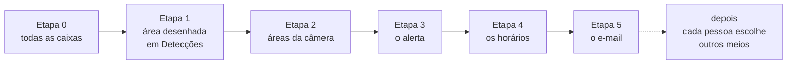

# TODO - áreas na imagem, filtro por área e alertas de detecção

Planejado em 20/10/2026, sobre a `a9a87f2` (v0.11.0). **Status: em andamento.
Etapas 0, 1, 2 e 4 feitas**, na branch `areas-e-alertas`; da 1, falta só a
medição no hardware de referência. **A Etapa 3 está feita, menos a
instalação de teste:** o campo `alert`, o `internal/alerta`, a aba Alerta, a
marca gravada na detecção e o "só alertas" em Detecções.

**Próximo passo:** a [Etapa 5](#etapa-5---o-e-mail) (o e-mail), que manda
pela seção `smtp` do PR #50. Os pontos em aberto foram decididos em
27/10/2026, e a implementação segue pelo checklist dela. A instalação de
teste da Etapa 3 fica para depois: por ora o mantenedor segue desenvolvendo e
testando na bancada local.

São quatro pedidos, e um se apoia no outro:

1. **Áreas na imagem**, várias por câmera, desenhadas no cadastro da câmera. A
   detecção continua sendo gravada onde quer que aconteça; a área decide só se
   o alerta sai.
2. **Filtrar Detecções por área**: pelas áreas cadastradas e por uma área
   desenhada na hora, em cima de um quadro.
3. **Alerta de detecção** por e-mail, atrás de um contrato que aceite outros
   meios depois (Telegram, WhatsApp e afins). Antes do SMTP, o alerta aparece
   no log e na tela.
4. **Horários do alerta** por câmera: em que horas de cada dia da semana, de
   domingo a sábado.

Tudo com a interface pensada para o celular e para o desktop.

## Checklist

- [x] [Etapa 0 - toda caixa que virou marca fica gravada](#etapa-0---toda-caixa-que-virou-marca-fica-gravada)
- [x] [Etapa 1 - filtrar Detecções por uma área desenhada na hora](#etapa-1---filtrar-detecções-por-uma-área-desenhada-na-hora), menos a medição no hardware de referência
- [x] [Etapa 2 - áreas cadastradas na câmera](#etapa-2---áreas-cadastradas-na-câmera)
- [ ] [Etapa 3 - o alerta: contrato, regra e registro](#etapa-3---o-alerta-contrato-regra-e-registro), menos a instalação de teste
- [x] [Etapa 4 - os horários do alerta](#etapa-4---os-horários-do-alerta)
- [ ] [Etapa 5 - o e-mail](#etapa-5---o-e-mail)

## Decisões do mantenedor

Tomadas em 20/10/2026:

1. **A detecção continua sendo gravada em qualquer lugar da imagem.** A área
   decide o alerta e serve de filtro. Ela não muda o que o detector de objetos
   olha, nem o que vira marca, nem os números medidos do
   `internal/detect/parametros.go`.
2. **Várias áreas por câmera**, cadastradas na tela da câmera.
3. **"Dentro da área" tem duas regras candidatas, e quem escolhe é o uso.** A
   Etapa 1 sai com as duas, e a padrão é escolhida olhando detecções reais (ver
   [As duas regras](#as-duas-regras)).
4. **Toda caixa que virou marca passa a ser gravada**, e não só a de maior
   confiança de cada família. Vale daqui para frente; o que já está gravado
   fica como está.
5. **Destinatários do e-mail:** na primeira versão, uma lista no
   `dwnvr.yaml`, **opcional**. Preenchida, ela recebe o alerta de toda câmera
   com alerta ligado. Depois, cada pessoa que entra no dwnvr escolhe de quais
   câmeras quer receber (ver [Depois](#depois)).
6. **Antes do SMTP, o alerta vai para o log e para um card Alertas no
   Diagnóstico.** Os Avisos continuam sendo o que está errado no sistema: só
   ganham uma linha quando um meio de envio falha. Em 23/10/2026 o card deu
   lugar à marca gravada na detecção e ao filtro "só alertas" em Detecções
   (ver a Etapa 3).
7. **Um contrato para os meios de envio**, para Telegram, WhatsApp e outros
   entrarem depois sem mexer no resto.
8. **Horários por câmera**, por dia da semana.
9. **Tudo numa branch à parte, a `areas-e-alertas`**, que faz o papel de
   `main` da feature. Ir para a `main` fica em aberto: a feature pode ir
   inteira, em parte, ou não ir (ver [Como entregar](#como-entregar)).

## O que o código já diz

Conferido na `a9a87f2`. É o que muda a conta das etapas:

1. **A marca de objeto é de chegada, e não de presença.** O rastreio
   (`internal/detect/marcador.go`) só marca caixa em lugar livre. Para o
   alerta, isso quer dizer:
   - um alerta por chegada, e não um por olhada: o carro parado na garagem
     avisa uma vez;
   - quem anda pela cena muda de lugar a cada olhada e marca de novo em cada
     uma: uma pessoa atravessando o quintal vira vários alertas. O freio
     (o silêncio) ficou para depois do plano (ver
     [O silêncio, medido e adiado](#o-silêncio-medido-e-adiado));
   - a memória do rastreio não sobrevive a um reinício: depois dele, o objeto
     parado aparece uma vez como se tivesse acabado de chegar. Na timeline já é
     assim.
2. **A marca guarda uma caixa por família**, a de maior confiança
   (`Recorder.olhou`, em `internal/recorder/recorder.go`). Com duas pessoas no
   quadro, a caixa da outra se perde. É o que a Etapa 0 muda.
3. **A caixa é fração do quadro**, de 0 a 1. O quadro da detecção
   (`quadros/{dia}/{instanteMs}.jpg`, 480 px de largura) e o keyframe do
   segmento (`/api/rec/thumb`) têm o enquadramento do stream. Uma área guardada
   em fração vale sobre os dois, em qualquer resolução, e se compara com a caixa
   sem conversão.
4. **A marca chega atrasada.** Ela leva o instante do onset, mas só é gravada
   depois da olhada: antes vêm a janela do pico (3 s), a espera na fila e a
   olhada em si (3,6 a 6,5 s num Orange Pi Zero 3). Na reencenação que fixou a
   fila, o atraso foi de 16 s no p90 e de 30 s no p99. O alerta herda esse
   atraso.
5. **A detecção não marca toda chegada.** No nível 4, o mecanismo dispara em
   41,5% das chegadas, e cerca de um terço de todas elas chega à timeline com a
   família certa. O alerta avisa do que a detecção marcou e herda isso: **não é
   alarme**, e a tela e a doc precisam dizer.
6. **Detecções pagina por cursor, no servidor.** As marcas de objeto de cada
   dia ficam na memória do store (0,85 MB com 7.987 detecções, medido), e o
   calendário lê todas as câmeras de todos os dias (1,2 s com o cache de disco
   frio, ~5 ms depois). O intervalo de horário é filtrado na tela porque corta
   só as pontas da lista. Uma área corta no meio, e por isso o filtro dela vai
   ao servidor: na tela, as páginas viriam quase vazias, e a rolagem pediria
   dezenas delas.
7. **Mudar a câmera não reconecta, salvo áudio, segmento e stall**
   (`recordingParamsChanged`, em `internal/recorder/manager.go`). Área e alerta
   entram pelo `trocaCamera`, com a gravação no ar.
8. **O `POST /api/cameras` lê até 16 KB.** Oito áreas de 20 pontos ocupam
   ~3 KB.
9. **O viewer recebe as câmeras resolvidas** no `GET /api/cameras`: o que for
   campo da câmera chega também à tela do viewer.
10. **Os Avisos são o estado do sistema** (`web/src/lib/avisos.ts`): o que
    está errado agora, derivado do `/api/health`. O sino do header os conta e
    fica vermelho com um só. Uma pessoa detectada não é defeito.
11. **O `docs/deteccao.md` diz que a detecção "não avisa ninguém".** Muda com
    a Etapa 3.
12. **A área não descarta nada.** Ela não muda o que é olhado nem o que vira
    marca: é uma escolha de uso ("onde me importa"), e não um ajuste técnico da
    detecção que caia no colo de quem usa.
13. **O De e o Até já existem**: o `IntervaloDeHorario` e o `CampoHora` de
    Detecções, com a regra de que o "até" menor que o "de" termina no dia
    seguinte. Os horários do alerta reaproveitam o `CampoHora`, mas não a
    regra: nenhum horário do alerta atravessa a meia-noite (24/10/2026).

## A sequência



**Começar pelo filtro de uma área desenhada na hora, a ideia do mantenedor, é
o melhor começo**, por quatro motivos:

1. É onde nascem as duas peças que todo o resto usa: o editor de área, a parte
   mais difícil de acertar no celular, e o teste "o objeto está na área?".
2. Não guarda nada: nem `cameras.json`, nem `dwnvr.yaml`, nem mudança
   incompatível. É a fatia mais barata.
3. É a bancada da regra. Com as duas regras sobre detecções reais, a padrão é
   escolhida antes de ela decidir quem recebe um e-mail às 3 da manhã.
4. Prepara o alerta. Com as áreas da câmera (Etapa 2), filtrar Detecções por
   elas mostra exatamente o que teria alertado.

O cuidado: o mock do editor já considera os dois lugares onde ele vai morar, a
folha da detecção e o cadastro da câmera, para a Etapa 2 não refazer o
componente.

**A Etapa 0 vem antes** porque é pequena e porque o histórico com todas as
caixas só começa no deploy dela: quanto antes, mais dado certo para testar o
filtro da Etapa 1.

**Os horários vêm logo depois do motor do alerta, e o e-mail por último**
(decisão do mantenedor, 22/10/2026, que inverteu a ordem do plano): o primeiro
e-mail de verdade já sai só nas horas escolhidas para a câmera. Na ordem
contrária, até os horários existirem, ele chegaria dezenas de vezes por dia
nas câmeras movimentadas (ver
[O silêncio, medido e adiado](#o-silêncio-medido-e-adiado)).

### Como entregar

**Tudo na branch `areas-e-alertas`** (decisão do mantenedor, 20/10/2026),
criada da `origin/main` na `a9a87f2`. Ela faz para esta feature o papel da
`main`: recebe só commits fechados, um por mudança, cada um com o `dist` e a
doc do que mudou. Ir para a `main` fica em aberto, porque ainda não se sabe
como a feature vai se desenrolar: ela pode ir inteira, em parte, ou não ir. Se
for, vai commit a commit, por rebase, sem squash e sem merge commit.

O plano recomendava a `main` aos poucos, um PR por etapa. Com a branch longa,
três cuidados seguram o custo:

- **Rebasear sobre a `main` no começo de cada etapa**, quando ela andou.
  `Deteccoes.svelte`, `Cameras.svelte`, `api.ts` e o `internal/api/dist/` mudam
  em quase todo PR da `main`, e o conflito pequeno de cada vez sai mais barato
  que o grande no fim. O `dist` é refeito em cada commit rebaseado, nunca
  costurado à mão. Depois de a branch ir ao GitHub, rebasear pede
  `--force-with-lease`.
- **Testar no uso por deploy manual.** A instalação de teste se atualiza pela
  `main`, e a branch só chega lá à mão.
- **O uso de uma etapa pode mudar uma anterior.** A regra da área, escolhida no
  uso da Etapa 1, muda a 2 e a 3. Numa branch que faz papel de `main`, isso é
  um commit novo de ajuste ou o amend do commit da etapa, como o mantenedor
  preferir na hora.

### O fluxo de cada etapa

1. Na branch `areas-e-alertas`, rebaseada sobre a `main` se ela andou.
2. Com decisão de tela, um mock HTML local com as variantes lado a lado, nos
   tokens e classes do `web/src/app.css`, em 390 px e 1280 px. Imagem real de
   câmera só no mock local, nunca no repositório.
3. Implementar, com `make test` e `prek run --all-files` verdes.
4. O mantenedor testa: no celular, build + `vite preview`; quando o servidor
   muda, um dwnvr local com cópia dos eventos da instalação de teste, ou a
   branch na própria instalação de teste, por deploy manual.
5. O diff e a mensagem; o commit só com o ok do mantenedor. O push da branch
   fica com o mantenedor.
6. A etapa marcada neste arquivo, no mesmo commit.

## Vocabulário

| Termo | O que é |
| --- | --- |
| **área** | um polígono sobre a imagem de uma câmera, em fração do quadro. Várias por câmera, cada uma com nome |
| **regra da área** | quando um objeto conta como dentro: `encosta` ou `pisa`, que no JSON são `touch` e `foot` |
| **alerta** | o aviso de que uma detecção passou na regra de alerta da câmera |
| **horário** | um item do `schedules`: os dias, um De e um Até, dentro de um dia só. Sem nenhum, o alerta sai sempre |
| **meio** | por onde o alerta sai: e-mail, depois outros |
| **registro** | a linha do alerta no log e a marca `alert` na detecção. Todo alerta tem, com meio configurado ou não |
| **silêncio** | o tempo, depois de um alerta, em que a mesma câmera e família não alertam de novo. Adiado: ver [O silêncio, medido e adiado](#o-silêncio-medido-e-adiado) |

## O modelo de dados

Decidido em 20/10/2026. Chave e valor novos em en-US (ver o `AGENTS.md`); o
que já existe em português, como a família `"pessoa"`, entra como é. Os nomes
no Go seguem em português (`Area`, `RegraDaArea`).

| Etapa | Onde mora | O quê |
| --- | --- | --- |
| 1 | só na URL e na query | `area=<cam>:<x>,<y>,...` em milésimos e `rule=touch\|foot` |
| 2 | `cameras.json`, dentro da câmera | `areas`: `id`, `name`, `rule`, `points` |
| 3 | `cameras.json`, dentro da câmera | `alert`: `enabled`, `families`, `areas` |
| 3 | `eventos/{dia}.ndjson`, na linha do objeto | `alert` e `alertAreas`, a marca de quem alertou |
| 4 | dentro do `alert` | `schedules`: `days`, `from`, `to` |
| 5 | `dwnvr.yaml` | `alerts.email.to`; o envio é o da seção `smtp`, do PR #50 |

- **Área e alerta dentro da câmera**, e não num arquivo próprio: aproveitam o
  `ConfereCamera`, o `trocaCamera` e o `GET /api/cameras`, que já leva tudo ao
  viewer. O preço é o downgrade, que vai nas notas da release.
- **Os pontos em fração, com 4 casas**, como a `caixa`, que se compara com a
  área sem conversão. Na query, milésimos inteiros, para a URL ficar curta.
- **O alerta fica gravado na detecção** (decisão de 23/10/2026, na Etapa 3),
  e não numa lista em memória: a marca vai na linha do objeto que alertou.

## As duas regras

| Regra | Conta como dentro quando | A favor | Contra |
| --- | --- | --- | --- |
| `encosta` | a caixa e a área têm algum ponto em comum | é o que se espera sem pensar; pega o objeto pela metade na borda | em perspectiva, quem está perto da câmera cobre a área que fica atrás: a pessoa no quintal encosta no portão do fundo |
| `pisa` | o meio da borda de baixo da caixa, onde ficam os pés e as rodas, está dentro da área | a área se desenha no chão, e quem está na frente dela não conta | com os pés escondidos por um muro, quem conta é a borda do muro; e a tela precisa explicar que a área é o chão |

As duas são um teste geométrico proporcional aos pontos da área, sem alocar.

## Etapa 0 - toda caixa que virou marca fica gravada

**O que muda para quem usa:** duas pessoas que chegam juntas aparecem com as
duas caixas na miniatura e na folha de Detecções e sobre o vídeo de Gravações.
O filtro por área acha a detecção pela pessoa que estiver na área, seja ela a
de maior confiança ou não. Na timeline nada muda: continua uma chegada por
família.

**Como:**

- `Recorder.olhou` grava uma linha por objeto que virou marca, cada uma com a
  sua classe, confiança e caixa, todas no instante do onset e apontando para o
  mesmo quadro. Hoje é uma por família, com a de maior confiança (o mapa
  `melhor`).
- A linha não muda de forma: só passa a haver mais de uma da mesma família no
  mesmo instante.
- `Timeline.svelte` (`grupos`) junta por família dentro do instante. Sem isso,
  duas pessoas virariam dois ícones de pessoa, e o tique se dividiria em duas
  faixas da mesma cor.
- `/api/deteccoes` (`agrupa`) já junta as marcas do instante numa detecção, e
  passa a trazer todos os objetos. A miniatura, a folha e as caixas sobre o
  vídeo já desenham o que vier.
- O calendário (`contaDeteccoes`) conta instantes, e o funil conta olhadas:
  nenhum dos dois muda.
- A cauda de Gravações (`caudaDeEventos`) descartava o que já tinha por
  instante e família. Passa a comparar a caixa: a rodada que caísse entre as
  duas linhas da mesma família perderia a segunda até recarregar a página.

**Descartado:** aninhar as outras caixas na linha da família. Deixaria os
leitores de hoje intactos, mas o filtro, o alerta e a API teriam de olhar em
dois lugares para sempre.

**Medir depois do deploy:** quantos instantes passam a ter duas marcas da
mesma família, por câmera e por dia. É o tamanho do ganho, e o do crescimento
da memória das marcas.

**Não é mudança incompatível:** caminho, `DayLayout` e formato da linha são os
mesmos. Voltar para a versão anterior não quebra: ela lê as linhas a mais como
marcas extras no mesmo instante, e a timeline mostra dois ícones.

**Repercussões:** `docs/arquitetura.md` (§Armazenamento, a linha de objeto),
`docs/deteccao.md` (o passo 7, "grava no máximo uma marca por família"),
`docs/api.md` (`/api/rec/events`, e "Pessoa e carro no mesmo quadro são duas
marcas" em §Detecções).

- [x] uma linha por objeto no `Recorder.olhou`, com teste
- [x] a timeline junta por família no instante
- [x] docs
- [x] print de uma detecção com duas caixas da mesma família
- [x] ~~a medição do primeiro dia no ar~~: dispensada em 20/10/2026. O
  mantenedor viu no ar, no primeiro dia, duas caixas de pessoa no mesmo quadro,
  e isso basta para fechar a etapa; a contagem por câmera e por dia não mudaria
  nada do que vem depois.

## Etapa 1 - filtrar Detecções por uma área desenhada na hora

**O que muda para quem usa:** em Detecções, desenhar uma área em cima do
quadro de uma câmera e ver só as detecções com objeto dentro dela. É a
pergunta "quem passou pelo portão nesta semana?".

**Como fica**, decidido no mock em 20/10/2026:

- **Duas entradas.** Na folha de uma detecção, o botão "filtrar por área" fica
  ao lado de "ocultar câmera", desenha sobre aquele quadro, e a câmera já é a
  dela. Na barra, um botão de área pede a câmera num popover e abre o quadro
  da detecção mais recente dela, ou o keyframe do último segmento quando ela
  não tem detecção. No celular o botão fica na 1ª linha, junto do intervalo;
  se apertar em alguma largura, muda de lugar. No desktop ele vem logo depois
  do intervalo, com o nome escrito.
- **O editor é o polígono livre** (a variante A do mock): cada toque põe um
  vértice, e tocar no primeiro fecha a área. Arrastar um vértice ajusta, e há
  desfazer e limpar. No celular, em retrato e deitado, na tela cheia; deitado,
  os controles vão para uma coluna à direita. No desktop, um modal. Foram
  descartados o retângulo que vira polígono (B) e o pincel numa grade (C), que
  trocaria o polígono por uma grade nas Etapas 2 e 3.
- **Aplicado, um chip na barra**, como o do intervalo de horário: a câmera e
  "área". Tocar reabre o editor, e o ✕ limpa. No celular, com o intervalo
  também ligado, os dois chips dividem a 3ª linha; sozinho, ele a ocupa
  inteira. No desktop, os dois chips na mesma linha, como o intervalo hoje.
- **A regra é escolha do usuário**, num seletor do editor: `encosta` (a caixa
  toca a área) ou `pisa` (o pé, meio da base da caixa, está dentro), com
  `pisa` de padrão. O nome `pisa` fica por ora e pode mudar na tela depois. Com casos
  reais de 16 a 20/10/2026, de 20% a 43% do que a `encosta` mostra é gente que
  só aparece por cima da área, perto da câmera, ou um falso positivo parado
  na borda; o preço da `pisa` é desenhar a área cobrindo todo o chão onde o pé
  pode estar.
- **A área restringe só a câmera dela** (decisão do mantenedor, 20/10/2026,
  depois de ver a tela): as outras câmeras marcadas seguem na lista,
  inteiras. Desmarcar a câmera da área no botão de câmeras a tira da lista,
  como qualquer outra; desenhar a área numa câmera desmarcada a marca de
  volta. Uma área só por vez nesta etapa; várias, uma por câmera, ficam para
  a Etapa 2.
- **O contorno da área**, fino e tracejado, nas miniaturas; na folha, sempre.

**Servidor:**

- pacote novo `internal/area`, com o tipo `Area` (de 3 a `MaxPontosDaArea`
  pontos, em fração do quadro), o contrato `RegraDaArea` (o que em Java seria
  uma interface) com as duas implementações, o mapa nome -> construtor e o
  `parametros.go`;
- `GET /api/deteccoes` e `GET /api/deteccoes/dias` aceitam
  `area=<cam>:<x>,<y>,<x>,<y>,...`, em milésimos do quadro (inteiros de 0 a
  1000), e `rule=touch` (encosta) ou `rule=foot` (pisa), com `foot` de
  padrão;
- o filtro tira da detecção o objeto que não está na área, como o de família
  já faz, e a detecção que fica sem objeto sai da página;
- marca sem caixa, de antes de a caixa existir, fica de fora com o filtro
  ligado;
- o calendário segue a área, como segue câmeras e famílias. O intervalo de
  horário não segue, por decisão de 19/10/2026.

**Tela:**

- o editor é um componente próprio, num chunk à parte (`import()`), que a
  Etapa 2 reaproveita: quem não desenha área não baixa nada;
- a URL leva `area=` e `rule=`, e o link colado em outra aba mostra a mesma
  lista;
- o viewer também usa: o filtro não grava nada.

**Medir:** a página e o `/api/deteccoes/dias` com área, com o cache de disco
frio e quente, no hardware de referência. O teste por marca é barato; o que
importa é o calendário, que passa por todas as marcas de todos os dias.

**Como conferir:** área côncava (em L); caixa que só encosta na borda; área do
tamanho da imagem, que tem de dar o mesmo que sem filtro; câmera 4:3, em que a
caixa e a área são fração da imagem, e não da miniatura 16:9; link colado em
outra aba; o dedo no celular, em retrato e deitado.

**A regra padrão é a `pisa`** (`RegraDaAreaPadrao`), e o seletor fica. Na
Etapa 2, a regra vira campo de cada área cadastrada.

**Repercussões:** `docs/api.md` (§Detecções), `web/src/lib/api.ts`,
§Estrutura do `web/README.md` (o editor), árvore do `README.md`
(`internal/area/`).

**Não é mudança incompatível:** os parâmetros são novos e opcionais.

- [x] mock do editor (A, B, C), nos dois contextos, celular e desktop
- [x] `internal/area`, com teste das duas regras
- [x] `area=` e `rule=` na API, com teste
- [x] o editor, o chip e a URL
- [ ] a medição no hardware de referência, que fica para bem depois
- [x] teste do mantenedor no celular e no desktop, em 20/10/2026
- [x] a regra padrão escolhida: `pisa`, e o seletor fica
- [x] docs

## Etapa 2 - áreas cadastradas na câmera

**O que muda para quem usa:** no cadastro da câmera, o admin desenha e dá nome
às áreas dela, como "Portão" e "Garagem". Em Detecções, qualquer pessoa filtra
por elas sem desenhar de novo.

**O dado**, no `cameras.json`, dentro da câmera:

```json
"areas": [
  { "id": "k3f9a2", "name": "Portão", "rule": "foot",
    "points": [[0.12, 0.30], [0.55, 0.30], [0.55, 0.80], [0.12, 0.80]] }
]
```

- O `id` é curto e gerado pelo servidor quando a área chega sem ele. O link de
  Detecções e o alerta apontam para ele, e renomear a área não quebra nenhum
  dos dois.
- `ConfereCamera` confere: nome não vazio e sem repetir na câmera; até
  `MaxAreasPorCamera` áreas; de 3 a `MaxPontosDaArea` pontos; coordenadas de 0
  a 1. A API recusa com o motivo, e o boot tira a área inválida e avisa, como
  já faz com os outros campos.
- A `rule` é a da Etapa 1, escolhida no editor, e vale para o filtro e para o
  alerta daquela área. Ausente, é a `RegraDaAreaPadrao`.
- Muda com a gravação no ar (`trocaCamera`).

**Como fica**, decidido no mock em 21/10/2026:

- **O formulário da câmera vira abas** (a variante C): Gravação, Detecção,
  Áreas e Alerta, com os horários dentro de Alerta. O mantenedor já pensava em
  abas para o cadastro. Foram descartadas a seção no fim do formulário (A),
  que o dobrava de tamanho, e a folha própria aberta por um botão no card (B),
  que abria uma segunda porta para a mesma câmera.
- **As abas vêm antes, num PR à parte para a `main`**, só com o que existe
  hoje (Gravação e Detecção). Esta branch se rebaseia sobre ele antes de mexer
  no formulário, e as abas Áreas e Alerta entram aqui.
- **Da B fica só o card:** uma linha nova com as áreas da câmera (a miniatura
  com os contornos e "2 áreas") e o estado do alerta ("alerta: pessoa" ou
  "alerta desligado"). Só mostra: quem muda é o "editar".
- **Na aba Áreas:** a lista, cada área com a miniatura, o nome e a regra, e
  "nova área", que abre o editor da Etapa 1 com o nome, a regra e "apagar
  área". As outras áreas da câmera aparecem em cinza no editor.
- **o quadro de fundo:** o keyframe do último segmento, decodificado no
  navegador em tamanho cheio, com um "atualizar o quadro". O `thumbs.ts`
  reduz a imagem para a tira de miniaturas, e assim não serve. A outra opção é
  o quadro da última detecção, de 480 px;
- **a aba Áreas só existe com a detecção**, decidido em 21/10/2026: com a
  marcação de movimento ligada na aba Detecção e o detector de objetos
  configurado. Sem os dois a câmera não tem detecção, e a área não teria o que
  filtrar. Desligar a marcação esconde a aba, mas não apaga as áreas.
  **Revisto em 23/10/2026** (decisão do mantenedor): as abas Áreas e Alerta
  aparecem sempre, e sem detecção dizem o que falta, porque escondidas
  ninguém saberia que existem;
- **o cadastro guiado passa por Áreas**, decidido em 21/10/2026: deixa claro
  que a opção existe. A câmera nova ainda não gravou, então a aba só avisa que
  dá para desenhar depois de salvar, em editar.
- **"salvar como área da câmera" existe** (a opção X): um botão no editor da
  Etapa 1, só para o admin, que pede o nome, grava no cadastro e passa o
  filtro a apontar para a área salva. Na tela ele é o "salvar na câmera", ao
  lado do "aplicar"; o editor de Detecções mostra em cinza as áreas que a
  câmera já tem, para todo mundo. A tela relê o cadastro antes e manda a
  câmera inteira pelo `POST /api/cameras`, sem endpoint novo.

**Em Detecções:** o botão de área lista as áreas cadastradas, por câmera, mais
"desenhar uma área". Escolher várias soma: qualquer uma serve, a desenhada
junto. A URL leva `areas=<cam>/<id>,<cam>/<id>`, separadas por vírgula como as
câmeras de `cams`, e o servidor resolve pelo cadastro: editar a área muda o
filtro dali em diante, inclusive sobre o passado. O link com uma área que não existe mais
abre sem ela, e a API a recusa.

**O enquadramento:** se a câmera for movida, a área fica no lugar errado. A
doc diz para redesenhar, e o editor sempre mostra o quadro atual.

**Repercussões:** campo em `config.Camera`: `config.Resolve`,
`config.ConfereCamera`, `Cameras.svelte` e §Política por câmera do
`docs/configuracao.md`. E ainda `docs/api.md` e `web/src/lib/api.ts`.

**Não é mudança incompatível**, com uma ressalva para as notas da release:
voltar para uma versão anterior e salvar a câmera apaga as áreas dela, porque a
versão velha não conhece o campo.

- [x] mock do cadastro (A, B, C), já com as seções de alerta e de horários
- [x] as abas no formulário da câmera, num PR à parte para a `main` (#45)
- [x] o campo `areas`, com validação e teste
- [x] a aba Áreas no formulário da câmera, com o editor da Etapa 1
- [x] a linha do card com as áreas (a miniatura e "2 áreas"); o chip "alerta: pessoa" entra na Etapa 3
- [x] o filtro por área cadastrada em Detecções
- [x] "salvar como área da câmera" no editor de Detecções (a opção X, admin)
- [x] teste do mantenedor no celular e no desktop, em 21 e 22/10/2026. Os
  ajustes de layout por tamanho de tela ficam para o fim da feature, numa
  lista do mantenedor
- [x] docs

## Etapa 3 - o alerta: contrato, regra e registro

**O que muda para quem usa:** no cadastro da câmera, "avisar quando
detectar", com as famílias e as áreas que contam. Nesta etapa o alerta vai para
o log e fica marcado na detecção, visto em Detecções; os horários são a Etapa 4, e o
e-mail, a 5.

**O dado**, no `cameras.json`, dentro da câmera:

```json
"alert": { "enabled": true, "families": ["pessoa"], "areas": ["k3f9a2"] }
```

- `areas` vazio é a imagem inteira. A tela diz isso por extenso, "em qualquer
  lugar da imagem" ou "só nas áreas marcadas", porque desmarcar todas as áreas
  não pode parecer "sem alerta".
- `families` começa em `pessoa`, a de maior prioridade. Uma câmera voltada para
  a rua, com `veiculo`, daria até ~450 alertas por dia: é quanto uma câmera
  assim marca de veículo na instalação de teste.
- Desligar guarda o resto, para religar sem refazer.
- A seção só funciona com o detector de objetos configurado e a marcação de
  movimento ligada na câmera: sem marca de objeto, não há o que avisar. Sem
  eles, ela diz o que falta (decisão do mantenedor, 23/10/2026).
- **O alerta nunca passa para a imagem inteira sem ninguém ver** (decisão do
  mantenedor, 23/10/2026). A área que a câmera não tem é recusada pela API, e o
  boot a tira com aviso. O alerta ligado que fica sem nenhuma das áreas que
  tinha, ou sem família, é desligado, também com aviso. Na tela, apagar uma
  área que o alerta usa pede confirmação, e, se for a última dele, a
  confirmação diz que o alerta será desligado.
- **A tela não salva o alerta incompleto** (23/10/2026): ligado sem família, ou
  com "só nas áreas marcadas" e nenhuma marcada, ela diz o que falta.
- **O viewer recebe do `alert` só o ligado** no `GET /api/cameras`,
  `"alert":{"enabled":true}`, sem as famílias e as áreas. Em 23/10/2026 ele não
  recebia nada; no mesmo dia, com o alerta gravado na detecção, o mantenedor
  decidiu que o viewer vê em Detecções o mesmo que o admin: o botão "só
  alertas", o sino e o bloco "alertou". O ligado é o que faz o botão aparecer;
  o que alertou vem marcado em cada detecção.

**Onde avalia:** dentro do `Recorder.olhou`, depois de montar as linhas e
antes de gravá-las, para a marca `alert` entrar na escrita (no passo 2 era
depois da escrita; mudou em 23/10/2026, com a marca gravada): o alerta tem os
mesmos números que Detecções mostra. O `Manager.olhou` passa ao
`Recorder.olhou` a `Regra` da câmera, montada no `Set`, e entrega à `Central` o
alerta que voltar; câmera sem alerta não tem regra, e a olhada dela custa um
`if`. Vale o instante do onset, que é a hora da cena, e não o da resposta.

**O alerta nunca segura a fila do detector de objetos.** O `olhou` roda na
goroutine da fila: esperar um servidor SMTP ali pararia as olhadas de todas as
câmeras. A `Central` conta o alerta, põe no log e o põe num channel com
buffer (`AlertasNaEspera`), e uma goroutine de envio o entrega aos meios. Com o
channel cheio, o alerta é descartado e contado. Sem meio, o channel e a
goroutine nem nascem: até a Etapa 5, nenhum.

**O contrato**, num pacote novo `internal/alerta` (o que em Java seria uma
interface):

```go
// Notificador é um meio de avisar alguém: o e-mail agora; Telegram e WhatsApp
// depois. Não guarda estado entre envios: quem decide o que vira alerta, e
// quando, é o pacote alerta.
type Notificador interface {
	// Envia entrega um alerta, e só volta quando o meio aceitou ou recusou,
	// dentro do prazo do ctx.
	Envia(ctx context.Context, a Alerta) error

	Nome() string
}

// Notificadores é o mapa de construtores: um meio novo entra numa linha. O
// construtor devolve nil quando o meio não está configurado no dwnvr.yaml.
var Notificadores = map[string]func(cfg *config.Config) (Notificador, error){
	"email": NovoEmail, // Etapa 5
}
```

- O `Alerta` leva a câmera (id e nome), o instante do onset e o do quadro, os
  objetos que passaram na regra (família, classe, confiança, caixa e as áreas
  em que caíram) e o JPEG do quadro olhado.
- Todo alerta vira uma linha `INFO` no log, com a câmera, as famílias e as
  áreas, e fica marcado na detecção (ver abaixo, "O alerta fica gravado na
  detecção"). Esse é o **registro**, que existe com meio configurado ou sem.
  É ele que se testa nesta etapa.
- O `/api/health` leva só `alerts.total` (decisão do mantenedor, 23/10/2026):
  ele é relido a cada 5 s pelo Diagnóstico e a cada 30 s pelo sino. A lista
  em memória do `GET /api/alertas`, do passo 2, sai com a marca gravada.

**Sem silêncio, por ora** (decisão do mantenedor, 22/10/2026): toda olhada com
objeto que passa na regra da câmera vira alerta (a partir da Etapa 4, só
dentro do horário dela). Duas pessoas na mesma olhada são um alerta só, com os
dois objetos. O que já se mediu e as opções estão em
[O silêncio, medido e adiado](#o-silêncio-medido-e-adiado); o mantenedor volta
a eles depois do plano inteiro, se o alerta incomodar no uso.

**O objeto parado depois de um reinício** vira chegada na primeira olhada
(item 1 de [O que o código já diz](#o-que-o-código-já-diz)). Com a família
padrão, `pessoa`, ele só incomoda quando o modelo confunde algo parado com
gente, dentro da área. Com `veiculo` na garagem, cada reinício avisaria do
carro que está lá. As saídas:

- **a) aceitar e medir no uso.** Recomendo para começar.
- **b) uma olhada de aquecimento por câmera ao subir**, que ensina o rastreio
  sem marcar nem alertar. Conserta a timeline também; custa uma olhada por
  câmera a cada reinício e mexe no funil, porque é olhada sem onset, como a de
  [`TODO_olhada-forcada-sem-onset.md`](TODO_olhada-forcada-sem-onset.md).
- **c) gravar o rastreio em disco**, em segundo plano, e lê-lo ao subir.

Não alertar "a primeira olhada depois de subir" não serve: ela pode acontecer
horas depois, e ser justamente a chegada que importa.

**Escolhida a a** (decisão do mantenedor, 22/10/2026). A b chegou a ser
escolhida e desenhada, mas os pontos negativos dela pesaram mais. O desenho e
esses pontos estão em
[`TODO_olhada-de-aquecimento.md`](TODO_olhada-de-aquecimento.md).

**O alerta fica gravado na detecção, e se vê em Detecções** (decisão do
mantenedor, 23/10/2026). O card Alertas no Diagnóstico, com a lista em
memória, foi trocado por isto depois de dois mocks (o card, e o alerta dentro
de Detecções): os dois mostravam a mesma coisa, e a lista em memória sumia num
reinício.

- **O dado:** na linha do objeto que alertou, no `eventos/{dia}.ndjson`,
  `"alert":true` e, com áreas no alerta, `"alertAreas":[<id>]`, o id da área
  (e não o nome: renomear segue, apagar vira "área apagada"). O objeto que não
  passou na regra não ganha nada. Arquivo antigo vale como está, sem marca.
  Antes e depois, com a detecção real das 16:37:30 de 20/10 na Frente (alerta
  em pessoa e veículo, só na Calçada):

  ```json
  {"instanteMs":1792525050142,"familia":"pessoa","classe":"person","score":0.566,"quadroMs":1792525050171,"caixa":[0.2276,0.3703,0.2784,0.4249],"temQuadro":true}
  {"instanteMs":1792525050142,"familia":"pessoa","classe":"person","score":0.566,"quadroMs":1792525050171,"caixa":[0.2276,0.3703,0.2784,0.4249],"temQuadro":true,"alert":true,"alertAreas":["calcad"]}
  ```

  A pessoa de 0,40 do mesmo quadro, fora da Calçada, fica sem marca.
- **Onde:** na linha do objeto, e não numa linha própria, num arquivo
  `alertas/{dia}` ou num arquivo global. A marca é por objeto, só a linha dele
  a diz sem apontar "qual objeto"; sai na mesma escrita; a retenção é a do
  vídeo; e Detecções já lê esse arquivo. O resultado do envio (Etapa 5) chega
  depois e não caberia aí de qualquer jeito: se um dia for guardado, ganha
  lugar próprio.
- **A ordem muda:** a regra roda antes de gravar as linhas (hoje roda depois),
  para a marca entrar na escrita. A `Central` fica com o total, o log e os
  meios; o anel `recentes`, o `AlertasNaTela` e o `GET /api/alertas` saem. O
  `/api/health` mantém só `alerts.total`.
- **A API:** o objeto do `/api/deteccoes` traz `alert` e `alertAreas` (ids,
  como gravados; a tela põe o nome pelo `GET /api/cameras`), e o filtro
  `alert=1` deixa só as detecções com objeto que alertou.
- **A tela, variante A do mock:** um botão com o sino na linha de
  pessoa/veículo/animal, "só alertas" no desktop, que soma com os outros
  filtros e vai no link. Desligado, a grade é a de hoje e a miniatura que
  alertou ganha o sino no selo. Ligado: só alertas, o contorno tracejado das
  áreas do alerta, o nome da área na legenda e a caixa que não entrou no
  alerta tracejada e apagada. Na folha, o contorno das áreas sobre a imagem e
  um bloco "alertou" com cada objeto, score e área; o objeto de fora aparece
  embaixo, "não entrou no alerta".

**O Aviso de meio falhando fica para a [Etapa 5](#etapa-5---o-e-mail)**
(decisão do mantenedor, 23/10/2026), com o resultado em cada meio e os
descartados (que iam no card Alertas, que saiu: o lugar se decide na Etapa 5):
até o e-mail, não há meio que possa falhar, e nada disso
teria como ser visto funcionando. O contrato já leva o resultado de cada envio,
testado com um meio falso.

**No cadastro da câmera**, a seção Alertas desenhada no mock da Etapa 2:
ligar, famílias, onde (a imagem inteira ou as áreas marcadas) e para onde vai,
que até a Etapa 5 é "só o registro". E uma linha que diga o limite: o alerta
avisa do que a detecção marcar, e ela não pega toda chegada (item 5 de
[O que o código já diz](#o-que-o-código-já-diz)).

- Ela é a aba **Alerta**, a última, e vem num chunk à parte. Ela e a aba Áreas
  aparecem sempre: sem a marcação de movimento, mostram como ligá-la, com um
  botão para a aba Detecção; sem o detector de objetos, apontam para a doc de
  como configurá-lo. O que a câmera já tem fica guardado.
- A área nova ganha o `id` na tela, e não no servidor, para o alerta poder
  marcá-la antes de a câmera ser salva.
- No card, "alerta: pessoa, veículo" com o alerta ligado e "alerta desligado"
  com um alerta guardado; sem alerta, nada.

**Custo zero desligado:** sem câmera com alerta ligado, nada nasce: nem a
`Central`, nem channel, nem goroutine, nem os bytes da seção, que ficam num
chunk à parte. A `Central` nasce com a primeira câmera que liga o alerta e fica
até o dwnvr parar, para o total do `/api/health` não voltar a zero quando o
alerta é desligado. A marca na linha só existe no objeto que alertou: a linha
de quem não liga o alerta fica igual.

**Repercussões:** `docs/deteccao.md` (sai o "não avisa ninguém", e entram uma
seção sobre o alerta e os termos novos no vocabulário), `docs/api.md`
(`/api/health`, `alert` e `alertAreas` no `/api/deteccoes` e o campo da
câmera), §Política por câmera do
`docs/configuracao.md`, §Detecção de movimento e de objetos do `README.md`,
`web/src/lib/api.ts`, `web/README.md` e a árvore do `README.md`
(`internal/alerta/`).

**Não é mudança incompatível:** o campo é novo e opcional, e o alerta vem
desligado.

- [x] ~~a simulação do silêncio sobre o histórico real~~: feita em 22/10/2026,
  e o silêncio ficou para depois do plano
- [x] o campo `alert`, com validação
- [x] `internal/alerta`: o contrato, a regra e o envio, com teste
- [x] a avaliação depois do `Recorder.olhou`, sem segurar a fila, com o
  registro no log e no `GET /api/alertas` (os dois trocados logo abaixo)
- [x] a aba Alerta no cadastro, o chip "alerta: pessoa" no card e a
  confirmação ao apagar uma área que o alerta usa
- [ ] ~~o card Alertas~~: trocado em 23/10/2026 pelo alerta gravado na
  detecção, com o filtro "só alertas" em Detecções
- [x] a marca `alert`/`alertAreas` na linha do objeto, com a regra antes da
  escrita; sai a lista em memória e o `GET /api/alertas`
- [x] `alert` e `alertAreas` no `/api/deteccoes` e o filtro `alert=1`, que o
  viewer também recebe (decisão do mantenedor, 23/10/2026)
- [x] o botão "só alertas" em Detecções e o bloco "alertou" na folha, também
  para o viewer, que passa a receber o `alert.enabled`
- [ ] na instalação de teste, por deploy manual, com detecções reais: adiada
  (decisão do mantenedor, 23/10/2026), por ora segue na bancada local
- [x] docs

## Etapa 4 - os horários do alerta

**O que muda para quem usa:** por câmera, em que dias e horas o alerta sai.
Sem horário, ele sai sempre. A detecção continua gravando o dia inteiro: o
horário decide só o alerta.

**O dado**, decidido com o mantenedor em 23 e 24/10/2026, dentro do `alert`.
O exemplo é o dele, a quarta com três horários:

```json
"schedules": [
  { "days": [3], "from": "00:00", "to": "05:15" },
  { "days": [3], "from": "12:00", "to": "13:00" },
  { "days": [3], "from": "18:30", "to": "23:59" }
]
```

- Cada item é um **horário**: os dias e um De e um Até, ao minuto (`HH:MM`).
  Os horários se somam, e vários podem ter o mesmo dia.
- `days` vai de 0 (domingo) a 6 (sábado), como o Go e o JavaScript contam.
- **As duas pontas entram**, como no intervalo de Detecções: "até 13:00"
  inclui o minuto 13:00, e o dia inteiro é `00:00` até `23:59`.
- **Nenhum horário atravessa a meia-noite** (decisão do mantenedor,
  24/10/2026): o `to` é maior que o `from`, nunca igual. A noite são dois
  horários, um até 23:59 e outro a partir de 00:00 do dia seguinte. É a
  diferença para o intervalo de Detecções, em que o "até" menor que o "de"
  termina no dia seguinte.
- Sem `schedules`, ou com a lista vazia, o alerta sai sempre.
- Vale o instante do onset, no fuso do servidor, o mesmo que vira o dia das
  gravações.
- O nome fica `schedules`. O `activeHours` só caberia na hora cheia, que foi
  descartada.

**A validação**, no `ConfereCamera`, segue a da área:

- o horário inválido sai com um Aviso: sem dia, dia fora de 0 a 6, hora que
  não é `HH:MM` ou `to` que não é maior que o `from`;
- se todos saem, o alerta é desligado, como o que perde as áreas: sem horário
  ele valeria o tempo todo, e quem marcou só a noite receberia o dia;
- no máximo 84 horários por câmera, no `parametros.go`: é o que a grade pintada
  em xadrez gera (12 por dia), e o teto só barra o JSON editado à mão;
- dia repetido num horário conta uma vez, e horários que se sobrepõem valem
  pela soma.

**A avaliação:** a `Regra` monta os horários uma vez, no `NovaRegra`, e o
`Avalia` confere o instante do onset antes das famílias e das áreas. Fora do
horário nenhum objeto alerta, e a linha fica sem a marca. Mudar o horário não
mexe no que já foi gravado: a marca é da hora em que a detecção aconteceu. Sem
`schedules`, o teste não existe. O viewer continua recebendo só o
`alert.enabled`.

**Como fica**, decidido no mock em 23 e 24/10/2026 (variante A, ao minuto):

- A seção **Horários** fica dentro da aba Alerta, depois do "onde", com a caixa
  **"Limitar o alerta a alguns horários"**. Desmarcada, diz "O alerta vale a
  qualquer hora", e o salvar apaga o `schedules` (decisão do mantenedor,
  23/10/2026). Marcada e sem nenhum horário válido, o salvar barra.
- Embaixo da caixa, o fuso do servidor ("America/Fortaleza (UTC−03:00)"), que o
  `/api/health` já manda.
- **A grade da semana.** No desktop, os dias em linhas e as horas em colunas;
  no celular, virada, com os dias em colunas. Clicar numa hora marca ou
  desmarca; arrastar com o mouse marca um retângulo, no modo da primeira
  célula; o dia e a hora nas bordas marcam a linha ou a coluna inteira. No
  celular só o toque parado marca, porque arrastar rola a folha. A hora pela
  metade fica tracejada, com só o pedaço marcado pintado. Na folha de 460 px do
  desktop a célula fica com 15 x 18 px: miúda, mas o mouse acerta.
- **A lista digitada**, embaixo da grade: cada horário com os dias em botões
  (dom a sáb), o De e o Até do `CampoHora`, o ✕ e uma linha que diz como o
  dwnvr lê o horário ("seg a sex · 22:00 às 23:59"). Embaixo, "novo horário"
  e os atalhos "+ toda noite" (dois horários todo dia, 22:00 às 23:59 e 00:00
  às 05:59) e "+ fim de semana" (sáb e dom, o dia inteiro).
- **Grade e lista andam juntas.** Digitar repinta a grade. Pintar refaz a
  lista inteira na forma canônica: cada dia com as horas dele, e os dias com o
  mesmo horário num horário só. O horário pela metade (sem dia ou sem hora) vai
  para o fim, e o minuto que sobra sozinho sai (o 13:00 de "12:30 até 13:00"
  depois de apagar a hora 12).
- O mouse ou o foco num horário contorna as horas dele na grade.
- O "Até" que não fica depois do "De" avisa ao sair do campo, e diz como fazer
  a noite com dois horários.
- Ficaram de fora a variante B (o resumo na aba e um editor próprio, com a
  grade grande) e a hora cheia.

**Repercussões:** `config.ConfereCamera` e o `parametros.go`, a `Regra` do
`internal/alerta`, `AbaDoAlerta.svelte` (a seção e a grade), `CampoHora`
(reaproveitado), §Política por câmera do `docs/configuracao.md`, a seção do
alerta no `docs/deteccao.md`, o campo da câmera no `docs/api.md` e
`web/src/lib/api.ts`.

**Não é mudança incompatível:** o campo é novo e opcional.

- [x] mock (A, B; ao minuto e hora cheia), celular e desktop: A ao minuto, em
  23/10/2026, e nada atravessa a meia-noite, em 24/10/2026
- [x] o campo `schedules`, com validação e teste
- [x] o horário na `Regra`, com teste
- [x] a seção no cadastro: a grade, a lista e os atalhos
- [x] teste do mantenedor no celular e no desktop, em 24/10/2026, na bancada
  local
- [x] docs

## Etapa 5 - o e-mail

**O que muda para quem usa:** o alerta chega por e-mail, com o quadro da
detecção.

**O envio já existe.** O PR #50 (26/10/2026, `9cd5d25`) trouxe a seção `smtp`
do `dwnvr.yaml`, o `internal/email` (o contrato `Enviador`, com o
`PrazoDoEnvio` de 20 s), o aviso da seção recusada no card Avisos e o "Testar o
e-mail" do card Este servidor (`POST /api/email/teste`). A Etapa 5 não abre
outra conexão nem outra configuração de servidor: o meio `email` do alerta é
uma linha no `Notificadores` que manda pelo mesmo `Enviador` (reescrita em
27/10/2026; a versão anterior trazia uma seção própria com servidor e senha).

**A configuração** é só a lista de quem recebe, numa seção nova e opcional:

```yaml
alerts:
  email:
    to: [fulano@exemplo.com, ciclana@exemplo.com]
```

| Campo | O que é |
| --- | --- |
| `alerts.email.to` | recebem o alerta de toda câmera com alerta ligado |

- **O meio nasce com as duas coisas:** a seção `smtp` ligada e pelo menos um
  endereço no `to`. Sem `smtp`, o `to` sozinho vira Aviso ("os alertas não
  saem por e-mail: falta a seção smtp"), e não erro de boot.
- **Com o `to` vazio, o meio não nasce**, e a aba Alerta diz que o alerta fica
  só no registro.
- **Cada endereço é validado no boot**, com a mesma regra do e-mail do
  cadastro (`usuarios.ValidarEmail`): endereço só, sem nome na frente. O
  endereço inválido sai da lista com Aviso, e os outros seguem.

As três regras acima, e a do Aviso de meio falhando sumir no primeiro envio
que der certo, são decisão do mantenedor (27/10/2026).

**A mensagem:**

- o assunto leva a família de maior prioridade, a câmera e a hora do onset,
  como "Pessoa em Garagem às 14:32";
- o corpo leva o dia, os objetos e as áreas em que caíram;
- o quadro olhado vai anexo em JPEG, com as caixas e a área desenhadas.
  Desenhar é Go puro (`image/jpeg` e `image/draw`) sobre o quadro do
  `Alerta.Quadro`: medir no hardware de referência, em que a ordem esperada é
  de dezenas de ms. Feito em 27/10/2026 no `internal/alerta/quadro.go`: a
  Central desenha uma vez por alerta, antes de entregar aos meios, e o meio só
  monta e manda a mensagem. Só as caixas dos objetos que alertaram (decisão do
  mantenedor), na cor da família, e o contorno tracejado de todas as áreas do
  alerta, sem rótulo. A qualidade é a do quadro olhado (75): 85 deu ~25% a
  mais sem diferença visível. Medido numa máquina de desenvolvimento: ~5 ms e
  24-43 KB por quadro real de 480×270. No hardware de referência, em
  27/10/2026, com o dwnvr rodando ao lado (load 3,4) e o benchmark em `Nice`
  10: 37 a 46 ms por alerta e ~0,8 MB alocados, num quadro real de 480×270.
  Nos ~26 alertas por hora da instalação de teste, é ~1 s de CPU por hora;
- sem link para abrir a detecção: o servidor não sabe o endereço pelo qual é
  acessado, e o link de definir a senha usa o do navegador do admin. Fica para
  quando houver um campo para isso.

**Implementação:** biblioteca padrão do Go, sem C e sem dependência nova.

- **O anexo pede mexer no `internal/email`:** a `Mensagem` de hoje é texto
  puro (`text/plain` em quoted-printable). Ela ganha os anexos, e o `montar`
  passa a escrever `multipart/mixed` (`mime/multipart`, o JPEG em base64)
  quando houver anexo. Sem anexo, a mensagem sai byte a byte como hoje, para o
  link de definir a senha e o teste não mudarem.
- **Dois prazos, um dentro do outro:** o `alerta.PrazoDoEnvio` (30 s) é o
  `ctx` de cada envio, e o `email.PrazoDoEnvio` (20 s) é o do `Enviador`. O de
  dentro vence; o de fora segue valendo para os outros meios.
- **O teste do meio usa o servidor SMTP falso** do `internal/email`
  (`servidor_test.go`), que já fala STARTTLS e TLS. O Mailpit num container,
  com o SMTP na porta 1025 e a caixa de entrada na 8025, serve para olhar a
  mensagem montada de verdade, na bancada; o repositório não tem nada dele
  hoje.

**O teto por hora**, fixo no `internal/alerta/parametros.go`, e não no
`dwnvr.yaml` (decisão do mantenedor, 27/10/2026), para a instalação inteira:
protege a conta, porque o provedor bloqueia quem dispara demais. O Gmail
aceita 500 por dia numa conta comum (ver o `docs/configuracao.md`), e a mesma
conta manda o link de definir a senha: o número sai dessa conta, com o motivo
ao lado. O que passa dele é descartado e contado.

Feito em 27/10/2026: um ritmo com rajada, e não "no máximo N por hora"
(decisão do mantenedor): depois de `RajadaDeAlertas` (20) seguidos, passa um a
cada 4 min (`AlertasPorHora`, 15), e quem chega meia hora depois de uma rajada
ainda gera e-mail. O pior dia é 20 + 15 × 24 = 380, contra as 500 mensagens
por dia do Gmail, contadas por mensagem e não por destinatário (conferido na
página do Google). O teto é o GCRA do `internal/limite`, o mesmo do login, que
ganhou o `NovoGCRAACada` para um ritmo por hora, com uma chave só para a
instalação; a Central o recebe como `limite.Limitador`. Ele vale na entrada da
espera, então o alerta acima do teto não ocupa lugar na fila.

**O Aviso do alerta que não saiu** (decisão do mantenedor, 27/10/2026): o
descarte por fila cheia (`AlertasNaEspera`, 32) e o do teto por hora viram um
Aviso só, no card Avisos do Diagnóstico e no sino, como "12 alertas não saíram
por e-mail desde 14:02 (5min), o último às 14:07: a fila de envio encheu. Eles
estão gravados em Detecções, no filtro só alertas."

- **Amarelo (`warn`):** a gravação e a marca seguem. A fila só enche com o
  envio lento ou travado, e aí o Aviso vermelho de meio falhando aparece junto
  e explica o amarelo.
- **Some uma hora depois do último descarte**, e não no envio seguinte que der
  certo, como o de meio falhando: o descarte é um evento, e não um estado.
  Sumindo no envio seguinte, ele sairia da tela em segundos, e o sino, que
  relê a cada 30 s, podia nem acender.
- **O `/api/health`** leva a contagem, o primeiro e o último descarte, só com
  algum meio configurado.

**O Aviso de meio falhando**, que veio da Etapa 3: um Aviso `bad` só quando um
meio falha, com o "desde quando" dos outros avisos, como "Alertas por e-mail
falhando desde 13:58 (12min): o erro. As detecções seguem gravadas, mas
ninguém está sendo avisado." Vem do `/api/health`, como o aviso da seção
`smtp`, e some no primeiro envio que der certo.

Feito em 27/10/2026: o `/api/health` leva `alerts.failing`, um item por meio
falhando, com o nome, o desde quando e o erro mais recente. Os números do meio
vão no `/api/health/servidor` (`alertas`), e o card Este servidor ganha um
grupo por meio, "Alertas por e-mail", abaixo do grupo E-mail: enviados, falhas
e o último envio, ok ou falhou com o erro, na hora do servidor. Um grupo à
parte porque o e-mail do servidor não é o meio do alerta, e um meio novo ganha
o seu. Os dois somem antes de alguma câmera ligar o alerta.

**Decididos em 27/10/2026**, com um mock dos estados da aba Alerta (o card
Alertas saiu em 23/10/2026; ver a Etapa 3):

1. **Os números do meio** (enviados, falhas e o último resultado) ficam no card
   Este servidor do Diagnóstico, junto do e-mail que o #50 já mostra lá, só
   para o admin. Os descartados vão no Aviso acima.
2. **O botão "Enviar um alerta de teste" fica na aba Alerta**, dentro do bloco
   "Para onde vai", abaixo dos endereços (`POST /api/alertas/teste`). Manda o
   quadro de agora da câmera para a lista, com "[teste]" no assunto; não vira
   alerta nem marca nada em Detecções. O resultado aparece embaixo do botão:
   "Enviado às 14:32 para 2 endereços" ou a resposta do servidor do jeito que
   ela veio. Numa câmera ainda não salva ele fica desligado ("Salve a câmera
   para testar"); sem lista ou sem e-mail ele não aparece. A alternativa, no
   card Este servidor, pedia escolher a câmera e ficava longe de onde se
   configura o alerta.
3. **A aba Alerta mostra para onde vai**, num bloco "Para onde vai" que troca
   a frase fixa de hoje ("O envio por e-mail ainda não existe"): "Por e-mail,
   para 2 endereços", com os endereços (a aba é só do admin); "Só fica
   marcado na detecção", com o que falta (a lista `alerts.email.to`, ou a
   seção `smtp`); e, com o meio falhando, o "falhando desde" e o erro, em
   vermelho, como o Aviso. O viewer não recebe a lista.
4. **Uma mensagem para todos**, com a lista no `To`: cinco endereços são um
   envio, e contam um no teto. O `Enviador` do #50 já faz assim, com um `RCPT`
   por endereço na mesma conexão. Um endereço recusado no `RCPT` para a
   mensagem de todos, e o erro diz qual: na prática o Gmail não confere a
   caixa de outro domínio na hora, aceita e devolve depois ao remetente.

**Repercussões:** campo em `internal/config/config.go`: `dwnvr.example.yaml`,
com comentário, a seção do alerta no `docs/configuracao.md` (ao lado da seção
E-mail, que ganha "o alerta" entre os usos) e a §Configuração do `README.md`.
O `internal/email` ganha o anexo, com teste. Rota nova, se houver: `docs/api.md`
e `web/src/lib/api.ts`. Os limites do alerta, mais abaixo, ganham o do teto.

**Não é mudança incompatível:** a seção é nova e opcional, e o e-mail de hoje
sai igual.

- [x] decidir os quatro pontos acima, em 27/10/2026
- [x] a seção `alerts.email.to` no `dwnvr.yaml`, com validação
- [x] o anexo no `internal/email`, sem mudar a mensagem sem anexo
- [x] o meio `email` no `Notificadores`, com teste de um `Enviador` falso (o SMTP de verdade, com o anexo, é testado no `internal/email`) e conferido no Mailpit
- [x] o quadro com as caixas e a área desenhadas, medido
- [x] o teto por hora e o Aviso do alerta que não saiu
- [x] o Aviso de meio falhando, e os números do meio
- [ ] o bloco "Para onde vai" e o botão de teste, na aba Alerta
- [ ] docs

## Depois

Sem data. Cada item vira plano próprio quando chegar a vez.

- **Cada pessoa escolhe as câmeras** (decisão do mantenedor): o e-mail na
  Minha conta e as câmeras de que ela quer alerta, somados à lista global sem
  repetir endereço. O campo de e-mail no `usuarios.json` já existe (PR #50,
  que o PR #51 usa também para entrar), mas só o admin o preenche, na tela
  Usuários, e ninguém confirma o endereço. Falta a pessoa trocá-lo na Minha
  conta e, se ela mesma digitar, um e-mail de confirmação, para não guardar
  endereço digitado errado.
- **Outros meios**, cada um uma linha no `Notificadores`:
  - **Telegram:** um bot e o chat de destino. O `sendPhoto` manda o quadro, por
    HTTPS;
  - **ntfy:** um `POST` com o quadro anexo. Tem app no celular e pode rodar na
    própria casa;
  - **webhook genérico:** um `POST` com o JSON do alerta, para quem integra com
    outra coisa;
  - **WhatsApp:** não tem caminho simples. A API oficial exige conta business e
    mensagem pré-aprovada, e os caminhos não oficiais arriscam o bloqueio do
    número.
- **Regra por área:** famílias e horários diferentes em cada área, como
  "pessoa no portão a qualquer hora, veículo na garagem só à noite".
- ~~**Marcar em Detecções o que alertou**, e filtrar por isso~~: feito na
  Etapa 3 (23/10/2026), com a marca na linha do objeto e o "só alertas".
- **Um link para abrir a detecção** no alerta: pede um campo com o endereço
  público do dwnvr.
- **Notificação do navegador (push):** exige service worker, que o dwnvr evita
  de propósito (ver "Instalável como app, sem service worker" no
  `web/README.md`).
- **O silêncio**, se o alerta incomodar no uso: ver a seção abaixo.

## O silêncio, medido e adiado

Decidido em 22/10/2026: o alerta sai sem silêncio. O mantenedor volta a este
assunto depois de o plano inteiro estar feito, e só se o alerta incomodar no
uso. Fica aqui o que já se sabe, para não refazer.

**O problema.** A marca é de chegada (item 1 de
[O que o código já diz](#o-que-o-código-já-diz)): quem anda pela cena muda de
lugar e marca de novo a cada olhada. Uma pessoa 20 minutos no quintal, marcada
a cada minuto, são uns 20 alertas sobre ela.

**O que o silêncio faz.** Depois de um alerta, a mesma câmera e família não
alertam de novo por um tempo. A detecção segue gravada em Detecções e na
timeline: só o aviso não sai, e o que ficou de fora é contado. É por
câmera e família: a pessoa no Portão não cala a do Fundo, e o gato de um minuto
atrás não cala a pessoa de agora.

**As duas formas de contar o tempo:**

| Forma | Como conta | A favor | Contra |
| --- | --- | --- | --- |
| fixo | o tempo corre a partir do alerta | lembra que a cena continua | a presença longa vira um alerta a cada N minutos |
| deslizante | cada marca que cai no silêncio o reinicia | um alerta por episódio | numa câmera sempre movimentada ele nunca fecha, e quem chega no meio não avisa |

E a duração: mais longa manda menos alerta, e cala a segunda chegada que cair
dentro dela.

**Medido em 22/10/2026**, sobre 15 a 19/10/2026 da instalação de teste, no
nível 4, antes de o padrão virar 5: `pessoa` nas 9 câmeras, na imagem inteira,
o dia todo. Uma olhada é o conjunto das marcas de objeto de um mesmo
`instanteMs` no `eventos/{dia}.ndjson`, e o teste de área é o do
`internal/area`.

| Silêncio | Alertas por dia, somadas as 9 câmeras |
| --- | --- |
| nenhum | 629 |
| fixo, 1 min | 430 |
| fixo, 5 min | 247 |
| fixo, 15 min | 146 |
| deslizante, 5 min | 173 |
| deslizante, 15 min | 85 |
| fixo, 5 min, só das 22h às 6h | 12,6 |

- De dia, numa casa com gente, o silêncio não segura o volume: com 15 min
  fixo, as três câmeras mais movimentadas ainda dão de 27 a 37 alertas por dia
  cada. De dia, o freio é a câmera, a área e o horário.
- De noite o volume é pequeno, e o silêncio só segura a rajada sobre a mesma
  pessoa.
- Só nas áreas de teste de 4 câmeras: 113 por dia com 5 min fixo, e 70 com
  15 min.
- O nível 5 marca mais chegadas que o 4, e os números devem subir.

A recomendação, na época, foi o deslizante com 5 min. Sem silêncio, o único
freio do volume de e-mails é o teto por hora da Etapa 5.

## Os limites, para a doc do alerta

- **Um alerta por olhada.** Sem silêncio, quem fica andando pela cena gera
  vários alertas seguidos, um a cada olhada que o marcar de novo.
- **Não é alarme.** O alerta avisa do que a detecção marcou, e ela não marca
  toda chegada (item 5 de [O que o código já diz](#o-que-o-código-já-diz)).
  Subir a sensibilidade pega mais, e custa mais CPU.
- **Chega atrasado:** de segundos a meio minuto depois da cena, mais o tempo do
  próprio e-mail.
- **A fila descarta:** numa câmera agitada, o pedaço que não cabe na fila vira
  só movimento, e não alerta.
- **Falso positivo vira alerta falso:** o que o modelo confunde com gente,
  num lugar novo, avisa. A área, as famílias e o horário são o freio.
- **Com o detector de objetos fora do ar, nenhum alerta sai.** O Aviso que já
  existe diz desde quando.
- **Câmera movida, área errada:** é preciso redesenhar.
