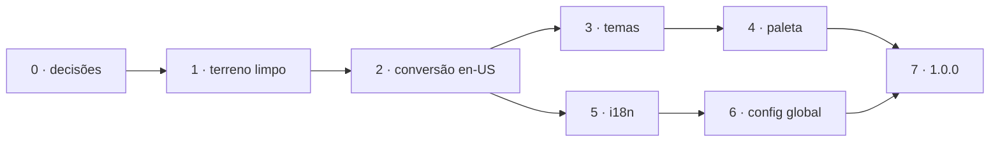

# Plano da 1.0.0

Levantado em 10/11/2026, a pedido do mantenedor: as seis atividades que ele
quer na 1.0.0, se fazem sentido e em que ordem. Aqui ficam o veredito de cada
uma, a ordem e o porquê dela, e as decisões que valem para todas. O andamento
se marca no [índice](README.md). O estudo de cada atividade está no arquivo
dela, nesta pasta, e o detalhe de implementação só se escreve quando a
atividade começar, no arquivo dela.

## Faz sentido?

| Atividade | Veredito | Em uma linha |
| --- | --- | --- |
| [SQLite](sqlite.md) | fica no radar, fora da 1.0.0 | As consultas pesadas já saem da memória depois da primeira, as migrations ficam mais rígidas e não mais flexíveis, e o custo foi medido: +4,3 MB de binário e +10 MB de RAM |
| [Conversão para en-US](conversao-en-us.md) | sim, e primeiro | Tudo o que vem depois nasce em en-US, e a 1.0.0 é a última hora de quebrar nome gravado sem pedir uma 2.0.0 |
| [Temas](temas.md) | sim | O tema já nasce de variáveis CSS; falta tirar ~115 cores escritas direto nos componentes e no canvas |
| [Paleta customizável](paleta.md) | sim, pequena | Depois dos temas, é um arquivo de tokens e um comando que o gera |
| [i18n](i18n.md) | sim | Abre o dwnvr para quem não lê português. Depende da conversão, que separa o texto da tela do código |
| [Tela de configuração global](configuracao-global.md) | sim, agora | O estudo de 07/10 a adiou por causa da herança dos defaults, que entrou no PR #47 |

## A ordem, e por quê

As setas são dependência. A ordem dos números é a recomendada.

- **Antes de tudo, a release do que já está na `main`.** Quem atualiza recebe
  as correções de agora sem esperar a conversão, que é incompatível, e a
  conversão começa de uma versão fechada.
- **A conversão vem primeiro** porque tudo o que vem depois nasce em en-US: os
  temas, a paleta, o i18n e a tela global seriam escritos em português para
  serem traduzidos em seguida. E é a etapa que mais sofre com trabalho em
  paralelo.
- **Os temas antes da paleta**, porque a paleta só troca o que for token, e é a
  Etapa 3 que põe toda cor num token.
- **Temas e paleta antes do i18n**, por tamanho e não por dependência: são
  etapas curtas e visíveis entre as duas maiores. Os textos novos do seletor de
  tema entram na extração do i18n junto com o resto.
- **O i18n antes da tela global.** A tela nasce nos dois idiomas, e o idioma
  padrão da instância, que o i18n cria para o e-mail de alerta (que vai a
  endereços, não a pessoas), já entra como campo dela.

## O tamanho de cada etapa

| Etapa | Tamanho | O que pesa |
| --- | --- | --- |
| 0 - decisões | conversa | fechada em 10/11/2026 |
| 1 - terreno limpo | pequena | a release do que está na `main` e o destino dos PRs #16 e #37 |
| 2 - conversão | a maior | ~67 mil linhas em ~265 arquivos, e o guia de atualização |
| 3 - temas | média | ~115 cores escritas direto em 24 arquivos, quatro paletas com contraste conferido, o canvas |
| 4 - paleta | pequena | o comando; o resto a Etapa 3 deixa pronto |
| 5 - i18n | grande | ~880 textos de tela, as mensagens do servidor, 3 e-mails, a formatação |
| 6 - config global | média | a revisão do estudo, o arquivo novo, a rota, a tela e aplicar sem reiniciar |
| 7 - 1.0.0 | pequena | a revisão dos contratos e a release |

## Sem compatibilidade, com um guia

Decidido em 10/11/2026. A conversão renomeia o que o dwnvr grava e o que quem
instalou escreveu, e a versão nova não lê o formato antigo: nada de nome antigo
aceito, nada de leitura dupla, nada de alias na API. O `AGENTS.md` (§Princípios,
"Chave e valor novos em en-US") manda hoje deixar como está o que já existe em
português; o passo 2 da conversão revoga essa regra.

O que quem atualiza precisa fazer vai num guia curto, claro e objetivo, num
documento novo em `docs/`:

- começa pelo backup, que é também o caminho de volta para a versão anterior;
- diz o que renomear no `dwnvr.yaml` e no compose, e como o que o dwnvr gravou
  passa ao formato novo;
- nasce em partes, uma por commit de contrato, e cada parte é aplicada à risca
  na instalação de teste antes da seguinte: chega à release já testado, e o que
  falhar lá volta para o guia;
- sai só em en-US, decidido em 11/11/2026: não ganha par em pt-BR como o
  README;
- é o que o rodapé `BREAKING CHANGE` da release manda seguir.

Ficam para o detalhe da Etapa 2:

- **Como o que o próprio dwnvr grava passa ao formato novo**, se por comandos
  no guia ou por uma flag de migração no binário. Comando de texto como o `sed`
  troca também o que a pessoa digitou: uma área chamada "pessoa" viraria
  "person".
- **O que acontece com quem atualiza sem seguir o guia.** O `dwnvr.yaml` e os
  JSON são lidos ignorando chave desconhecida, então o dwnvr novo sobe e grava,
  mas perde em silêncio o que estava nos nomes antigos: a sensibilidade e o
  mecanismo da detecção voltam ao padrão, e um alerta de `pessoa` não casa mais
  com `person` e deixa de sair, sem erro nenhum. Um aviso no log e no
  Diagnóstico ao achar o formato antigo, apontando o guia, resolve sem ser
  compatibilidade: o nome antigo continua sem valer.

## Uma release por etapa

Decidido em 10/11/2026: uma release 0.x por etapa, e a 1.0.0 só no fim, depois
da revisão dos contratos. A primeira é a da Etapa 1, com o que a `main` já tem
desde a v0.14.0. A conversão sai numa release só, no fim da etapa, com o guia
inteiro; até lá, cada passo dela é um PR, que roda na instalação de teste
antes de ser aceito.

A alternativa recusada, um salto só da 0.14.0 para a 1.0.0, juntaria seis
mudanças grandes numa atualização que, se desse errado, não diria qual delas
foi.

## O que a 1.0.0 promete

A proposta, para fechar na Etapa 7. Até a 2.0.0, não mudam de forma
incompatível:

- a API do `docs/api.md` (rotas, parâmetros e JSON);
- as chaves do `dwnvr.yaml`, as variáveis do compose e do `dwnvr-detect` e as
  flags do binário;
- o layout do disco, o que o `docs/arquitetura.md` descreve;
- os nomes dos tokens de cor, que a paleta da Etapa 4 publica.
