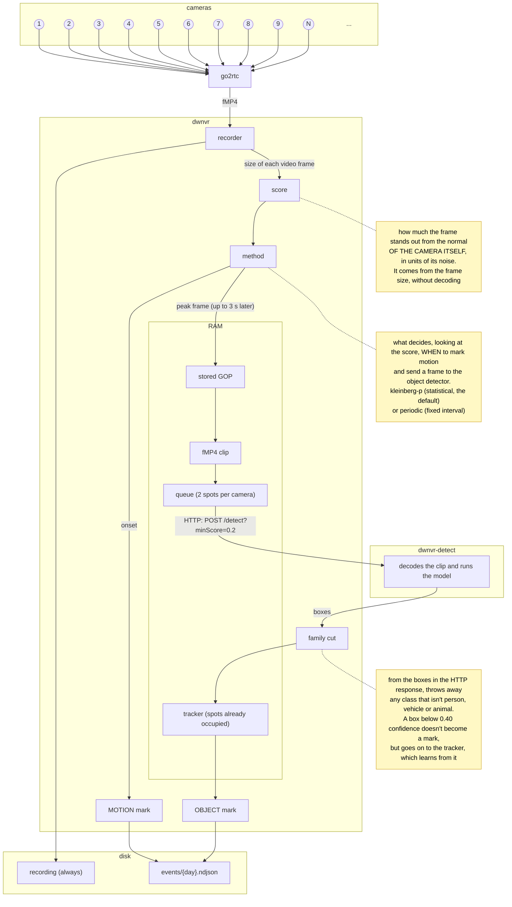

# Motion and object detection <!-- omit in toc -->

Detection puts two things on the timeline that recording alone doesn't say:
**when** there was motion and, with the object detector, **what** it was
(person, vehicle or animal). It is optional and ships turned off. Whoever only
records pays nothing for it.

How to turn it on and configure it is in [`configuration.md`](configuration.md).
Here is how it works inside, and why.

- [What it does, and what it doesn't](#what-it-does-and-what-it-doesnt)
- [The vocabulary](#the-vocabulary)
- [The path from a frame to the mark](#the-path-from-a-frame-to-the-mark)
- [dwnvr-detect](#dwnvr-detect)
- [A parked car doesn't become a mark on every inference](#a-parked-car-doesnt-become-a-mark-on-every-inference)
- [The alert](#the-alert)
- [The parameters, and where they live](#the-parameters-and-where-they-live)
- [The cost](#the-cost)
- [When dwnvr-detect goes down](#when-dwnvr-detect-goes-down)
- [The model's limits](#the-models-limits)
- [Where it is in the code](#where-it-is-in-the-code)

## What it does, and what it doesn't

**It does:**

- mark the instants of motion on the timeline, in an amber heat strip
- with `dwnvr-detect`, mark the **arrival** of a person, vehicle or animal,
  with an icon on the timeline and a box over the video
- show on the Diagnóstico (Diagnostics) screen what happened to each marked
  motion (the funnel) and the state of the object detector's queue
- with the alert on for the camera, record every inference that brings one of
  the chosen families, in the whole image or in the marked areas (see
  [The alert](#the-alert))

**It doesn't:**

- **record on motion.** Recording stays continuous; detection only annotates
  on top of it
- **decode video in dwnvr.** The motion comes from the frame sizes, and
  whoever decodes is `dwnvr-detect`, in a separate container
- **look at every frame.** The object detector looks at one frame per marked
  motion, not a continuous stream
- **act as an alarm.** The alert warns about what detection marked, and it
  doesn't mark every arrival. And its e-mail arrives from seconds to half a
  minute after the scene
- **recognize faces or license plates**, or learn from your home. The model is
  a single one, with the 80 COCO classes, and dwnvr uses 12 of them

## The vocabulary

| Term | What it is |
| --- | --- |
| **score** | how much a frame stands out from the normal OF THE CAMERA ITSELF, in units of its noise. It comes from the frame size, without decoding |
| **method** | what decides WHEN to trigger, looking at the score. `kleinberg-p` (statistical, the default) or `periodic` (fixed interval) |
| **onset** | the instant the method triggers. It becomes a motion mark, and is the instant the timeline shows |
| **sensitivity** | the level from 1 to 5. It is the **cost**: how many onsets per hour each camera generates |
| **peak** | the frame with the highest score in the 3 s after the onset. It is the one the object detector looks at, because at the onset the object is still half entering |
| **clip** | the stretch of video that goes to the object detector: from the GOP's I-frame to the peak frame |
| **inference** | a trip to `dwnvr-detect` with a clip, and its response |
| **family** | `person`, `vehicle` or `animal`: the grouping of the model's classes that the timeline colors. Priority is in that order |
| **arrival** | an object appearing where there wasn't one before. It is what the object mark records - not presence |
| **tracker** | the memory, per camera, of the spots already occupied by a stationary object |
| **funnel** | the destination of each onset: dropped, inferred with nothing new, with an object, still in progress or with no response |
| **area** | a named polygon drawn over a camera's image. It doesn't change what is looked at or what becomes a mark: it serves as a filter in Detecções (Detections) and decides the alert |
| **alert** | the notice that an inference brought a mark that passes the camera's alert rule |
| **channel** | how the alert goes out: e-mail, then others |
| **record** | the alert's line in the log and the `alert` flag on the object's line. Every alert has one, with a channel configured or not |

## The path from a frame to the mark



1. **The frame size.** The recorder already has on hand the size of each video
   frame, which is what it writes to disk. No pixel is decoded. A frame that
   carries more information than normal is a frame where something changed.
2. **The score.** `kleinberg-p` compares that size with the camera's own recent
   mean and deviation, and hides the I-frame, which is dozens of times bigger
   than the others and would drown the signal. Because each camera is compared
   with itself, the same sensitivity level means the same on a quiet camera and
   on one full of infrared noise.
3. **The onset.** When the score passes the level's threshold, the method
   triggers. A hysteresis (one threshold to open, another lower one to close)
   keeps a person crossing the scene from becoming twenty marks. The onset goes
   to `events/{day}.ndjson` as a motion mark, **with or without an
   inference**.
4. **The peak and the clip.** The method waits up to 3 s for the frame with the
   highest score, and dwnvr cuts the clip from the I-frame up to it, from the
   GOP it keeps in memory for each camera with detection.
5. **The queue.** A single one for all cameras, with two spots per camera. If
   the camera already has two clips waiting, the new one is **dropped**: it
   stays only as motion. That is what keeps the busiest camera from taking the
   others' turn.
6. **The inference.** `dwnvr-detect` decodes the clip, runs the model on the
   last frame and returns the boxes.
7. **The object mark.** dwnvr drops classes outside the families, applies the
   confidence cut and the tracker, and writes one mark per object that got
   through, all at the onset instant. Two people arriving together are two
   marks; the timeline merges the two into one `person` arrival.

Every object has motion underneath, but not every motion has an object.

## dwnvr-detect

A **stateless** HTTP endpoint: it receives a clip, returns the boxes of the last
frame. It has no queue, no memory and doesn't decide what becomes a mark.
Details on build, model and license in
[`dwnvr-detect/README.md`](../dwnvr-detect/README.md).

```text
POST /detect?minScore=0.2&frameWidth=480&quality=75
                          Content-Type: video/mp4, body: the clip
GET  /health              Docker's HEALTHCHECK and the "Este servidor" (This
                          server) card of the Diagnóstico; the queue doesn't
                          use it
```

```json
{
  "detections": [
    {
      "class": "person",
      "score": 0.87,
      "box": [0.41, 0.32, 0.47, 0.62]
    }
  ],
  "decodedFrames": 14,
  "width": 640,
  "height": 360,
  "timingsMs": {
    "decode": 181.3,
    "preprocess": 42.7,
    "model": 3391.5,
    "frame": 11.4
  },
  "frame": "/9j/4AAQSkZJRgABAQAAAQ… (base64)"
}
```

- **`box` is `[x1, y1, x2, y2]` as a fraction of the frame**, not in pixels: it
  is the only form that stays valid when the camera's resolution changes.
- **`frame` is the inferred frame as a JPEG**, at the width `frameWidth=`
  asked for, and only comes when there was a raw detection - nobody sees an
  onset frame with no object. It is the thumbnail of the Detecções screen. It
  comes from here because here it is already decoded, and the box, being a
  fraction, lands in the right place over it at any size. Measured on real
  frames: 13.8 KB at 480 px with quality 75, and ~11 ms to encode. dwnvr
  writes it to `frames/{day}/{atMs}.jpg`, see
  [`architecture.md`](architecture.md).
- **`minScore`** is the lowest confidence it returns, for any class. dwnvr
  sends 0.20, well below the 0.40 cut, because the tracker also learns from
  weak boxes.
- **One request at a time**, on purpose: on a 4-core board that also records,
  two inferences in parallel would be double the peak RAM without one more
  response per second. dwnvr does the queueing.
- **A clip that doesn't decode to the end returns `422`**: looking at the last
  frame left over would be looking at another instant.

**Why the split is exactly there:**

| Task | Who |
| --- | --- |
| record, compute the score, trigger the onset, find the peak | dwnvr |
| store the GOP and cut the clip | dwnvr |
| the queue: order, per-camera limit, dropping, timeout, pause | dwnvr |
| **decode the clip and run the model** | dwnvr-detect |
| family cut, tracker, write the mark | dwnvr |

1. **The sidecar has only what needs native code** - the video decoder and the
   model runtime. dwnvr stays pure Go, in an 8 MB image.
2. **All state stays in dwnvr.** The sidecar can restart at any moment without
   producing a false mark.
3. **Why Python, and not Go.** What runs the model is onnxruntime, in C++, and
   the RAM is the model's, not the language's: in Go and in Python the
   inference took the same time. In Python the sidecar uses the same libraries
   that exported the model, and gives the same boxes by construction.

## A parked car doesn't become a mark on every inference

The object detector doesn't know what "new" is: the parked car shows up in
every inference of that camera, and would be marked dozens of times a day. The
**tracker** (`internal/detect/marker.go`) remembers, per camera and per family,
where there is already an object. For each box, on every inference:

| The box | What happens |
| --- | --- |
| falls on an **already occupied** spot (same family, IoU overlap of at least 0.7) | **doesn't mark**, only confirms the spot |
| falls on a **free** spot, with confidence of at least 0.40 | **marks**, and starts occupying the spot |
| falls on a free spot, with confidence between 0.20 and 0.40 | doesn't mark, but **occupies** the spot |
| a spot goes **5 inferences in a row** without showing up | the spot is **released** |

The car arrives and marks once. It stays parked without marking. It leaves, and
the spot is released after 5 inferences. It comes back, and marks again.

- **Why a weak box occupies a spot:** the object detector "blinks". A
  stationary object passes the cut in some frames and not in others; if only
  what passes the cut occupied the spot, each blink would become a new
  arrival.
- **A failed inference doesn't count as a miss.** A miss is "I looked and
  didn't see"; a failure is "I didn't look". Otherwise, a few minutes with the
  sidecar down would release all the spots, and the parked car would be marked
  again when it came back.
- **The price:** if the car leaves and comes back with fewer than 5 inferences
  in between, the return doesn't mark (see
  [`TODO_olhada-forcada-sem-onset.md`](TODO/TODO_olhada-forcada-sem-onset.md)).
  And the memory doesn't survive a restart: after it, each stationary object
  shows up once as if it had just arrived.

## The alert

The alert is the camera's `alert` field (see
[`configuration.md`](configuration.md#per-camera-policy)): the families that
warn and, if any, the areas the object has to fall in, each by its own rule,
and the times it goes out. Without areas, the whole image counts; without
schedules, any time.

**When it goes out.** On every inference, right before the marks are written,
and with the same numbers as they have. With schedules, the onset has to fall
in one of them, to the minute and in the server's time zone; outside, no object
passes, and the detection is written without the flag. Inside, every mark of an
alert family that falls in the whole image or in one of the areas passes. All
those that pass go in a single alert, with the onset instant, which is the
scene's time: two people arriving together are one alert with both. Since the
mark is of an arrival, the parked car warns once, and whoever walks around the
scene warns on every inference that marks them again.

**It never holds up the object detector's queue.** The evaluation runs in the
queue's goroutine, and so only does in-memory math. What can wait, the send to
the channels, lives in a goroutine of its own, with a wait queue of
`QueuedAlerts`: with it full, the alert is dropped and counted, and is already
in the record.

**The record** is the flag on the line of each object that got through, in
`events/{day}.ndjson`, and an `INFO` line in the log. The flag is
`"alert":true` and, with areas in the alert, `"alertAreas"` with the id of the
areas the object fell in; an object that didn't get through has nothing:

```json
{"atMs":1792525050142,"family":"person","class":"person","score":0.566,"frameMs":1792525050171,"box":[0.2276,0.3703,0.2784,0.4249],"hasFrame":true,"alert":true,"alertAreas":["calcad"]}
```

```text
level=INFO msg=alert cam=portao families=person objects=2 areas=Portão
```

The flag is what held at the time: changing the camera's alert doesn't change
the past. It sits where the detection already sits, with the video's retention,
and shows in Detecções, with the "só alertas" (alerts only) filter (`alert=1`
in `/api/detections`, see [`api.md`](api.md)). `/api/health` carries the total
since dwnvr started and, with a channel configured, what feeds the Avisos
(Warnings): the channel failing and the alerts that didn't go out.

**By e-mail**, with the `alerts.email.to` list and the `smtp` section of
`dwnvr.yaml` (see [`configuration.md`](configuration.md#e-mail-alerts)): a
single message for the whole list, in HTML and with the plain text along with
it, for the e-mail reader that doesn't show HTML. The subject says the camera,
the areas some object fell in, in parentheses, the families and the onset time,
like "[Alerta] Garagem(Portão): pessoa e veículo às 14:32" ("[Alert] Garage
(Gate): person and vehicle at 14:32"); without an area, when the alert applies
to the whole image, it goes out without the parentheses. The body has the
dwnvr mark at the top, the inferred frame, when there is one, the day, each
object, with its confidence, and the areas it fell in. The frame goes inside
the body, as a JPEG, with the box of each object that alerted, in the family's
color, and the dashed outline of the alert's areas, as Detecções shows with the
"só alertas" filter. It is drawn once per alert, in the send goroutine, and
every channel receives the same one; if the drawing fails, it goes as it was
inferred. With `server.publicUrl` (see
[`configuration.md`](configuration.md#the-dwnvr-address)), the **Ver na
gravação** (View in the recording) button opens the Gravações (Recordings)
screen on the camera and at the onset instant; without it, the server doesn't
know the address it is reached at, and in place of the button the e-mail asks
the administrator to set it. The day and time in the link are the server's, and
the screen reads them in the browser's time zone: whoever opens from another
time zone lands offset. A send that fails goes to the log and becomes a red
warning, which goes away on the first send that works, and the alert stays in
the record. How to check the list and the send is in
[`configuration.md`](configuration.md#e-mail-alerts).

**Off, nothing.** If no camera has turned the alert on since dwnvr started,
nothing of the alert exists; the inference of a camera without an alert costs
an `if`. Without a channel configured, neither the wait queue nor the send
goroutine is born. After the last camera turns the alert off, the alert hub
stays until dwnvr stops, so the `/api/health` total doesn't go back to zero;
with a channel configured, the wait queue and the send goroutine stay with it,
idle.

### Alert limits <!-- omit in toc -->

- **One alert per inference.** There is no silence: whoever keeps walking
  around the scene generates several alerts in a row, one for every inference
  that marks them again.
- **It isn't an alarm.** It warns about what detection marked, and it doesn't
  mark every arrival. Raising the sensitivity catches more, and costs more CPU.
- **It arrives late:** usually from seconds to half a minute after the scene,
  which is the time of the peak window, the queue and the inference. With the
  queue full or the object detector slow, it goes beyond that: the inference
  waits for the response for up to a minute, and the clip may wait its turn in
  the queue before that.
- **The queue drops:** on a busy camera, a clip that doesn't fit in the queue
  becomes only motion, and doesn't alert.
- **The send has a ceiling:** after 20 alerts in a row, one goes out every 4
  minutes (15 per hour), for the whole installation; what comes before that is
  not sent, and a yellow warning says how many and why. It protects the e-mail
  account: Gmail stops sending after 500 messages in a day, and the worst day
  with the ceiling is 380. The ceiling doesn't survive a restart: every time
  dwnvr starts, the burst of 20 comes back whole. A full send queue, with the
  send slow or stuck, also drops and goes into the same warning. An alert that
  didn't go out stays recorded on the detection, like all of them. The numbers
  are in `internal/alert/params.go`.
- **With the disk failing, the alert goes out all the same:** the failure to
  write the flag goes to the log, and the detection may be missing from
  Detecções and from "só alertas", but the e-mail doesn't depend on the disk.
- **On dwnvr shutdown**, an alert still waiting to be sent doesn't go out, and
  a `WARN` line in the log says how many were left. It stays recorded on the
  detection, like all of them.
- **A false positive becomes a false alert:** what the model confuses with a
  person, in a new place, warns. The area and the families are the brake.
- **After a restart**, a stationary object shows up once as if it had just
  arrived (see [the tracker](#a-parked-car-doesnt-become-a-mark-on-every-inference)),
  and warns if it is of an alert family and in an alert area.
- **With the object detector down, no alert goes out.** The warning that
  already exists says since when.
- **Camera moved, wrong area:** it needs to be redrawn.
- **The time is the server's.** With the wrong time zone on it, the alert goes
  out at the wrong hours, the way the timeline turns the day at the wrong time
  (see [`operations.md`](operations.md#common-problems)). The Horários
  (Schedules) section of the Alerta (Alert) tab shows which time zone applies.
- **An object that arrived outside the schedule** doesn't warn when the
  schedule starts: the mark is of an arrival (see
  [the tracker](#a-parked-car-doesnt-become-a-mark-on-every-inference)), and it
  has already been seen.

## The parameters, and where they live

**What the user chooses** - see [`configuration.md`](configuration.md):

| Where | What |
| --- | --- |
| `cameras.json`, through the Câmeras (Cameras) screen | `detect`, `detectMethod`, `detectSensitivity`, `areas` and `alert` |
| `dwnvr.yaml` | `defaults` for the first three, and `detector.url` |
| `dwnvr-detect` env | `DETECT_THREADS`, `DETECT_MODEL`, `DETECT_PORT` |

**What is measured**, fixed in
[`internal/detect/params.go`](../internal/detect/params.go). Each number has
its why beside it. They are not preference, and changing one without measuring
again makes the measurement silently stop holding:

| Number | Value | What it is |
| --- | --- | --- |
| `OnsetsPerHour` | 6, 12, 25, 50, 100 | the cost of each level, per camera |
| `KleinbergPThreshold` | one per level | the threshold that makes `kleinberg-p` cost exactly what the level says |
| `PeakWindowMs` | 3 s | where to look for the frame to inspect after the onset |
| `FamilyCutoff` | 0.40 | the confidence from which a box can become a mark |
| `MinScore` | 0.20 | the lowest confidence the sidecar returns |
| `SamePlaceIoU` | 0.7 | the overlap that makes two boxes the same spot |
| `MissesToRelease` | 5 | inferences without seeing that release a spot |
| `ClipsPerCamera` | 2 | each camera's spots in the queue |
| `InferenceTimeoutMs` | 60 s | how long the queue waits for a response |
| `PauseAfterFailureMs` | 30 s | the queue's pause after a failed inference |
| `MaxGOPBytes` | 4 MB | the largest GOP stored per camera; a RAM brake |
| `ClassFamilies` | 12 classes | which COCO classes become `person`, `vehicle` or `animal` |

The alert's numbers, which are a design choice and not a measurement, live in
[`internal/alert/params.go`](../internal/alert/params.go):

| Number | Value | What it is |
| --- | --- | --- |
| `QueuedAlerts` | 32 | how many wait their turn to go out through the channels |
| `SendTimeout` | 30 s | how long a send can take before counting as a failure |
| `AlertBurst` | 20 | how many go out in a row before the ceiling applies |
| `AlertsPerHour` | 15 | the pace after the burst, one every 4 min, for the whole installation |
| `DropWarningLasts` | 1 h | how long the warning for the alert that didn't go out stays after the last drop |

## The cost

**Off, almost nothing.** On a camera with `detect` off, the method doesn't
exist, the GOP isn't stored and no request goes out: what is left, per frame,
is an atomic swap and an `if`. Without `detector.url`, the queue isn't even
born. `docker-compose.yml` only starts `dwnvr-detect` with the `detect`
profile, and whoever doesn't turn it on doesn't even download the image. In the
interface, the timeline doesn't ask for marks from cameras without detection,
and the boxes' code comes in a separate file, which only downloads when the day
has an object.

**On, the cost is the sensitivity level, and it is PER CAMERA.** With ten
cameras at level 4 that is 500 inferences per hour, not 50. Taking the Orange
Pi Zero 3 as reference:

| | Cost |
| --- | --- |
| motion mark (without the object detector) | negligible: an O(1) computation per frame, without allocating |
| stored GOP, per camera with detection | two buffers, in practice ~230 KB; at most 8 MB |
| one inference | ~6.5 s of one core with `DETECT_THREADS=1`, ~3.6 s with 2 (for ~10% more CPU in total). Without the variable, it uses 2 on a 4-core board |
| level 5, the default, per camera | ~17% of one core, continuous |
| level 4, per camera | ~9% of one core, continuous |
| the `dwnvr-detect` container | ~230 MB, with peaks of ~250 MB during inferences, and the model loaded even with no camera at all |

Level 5 doubles the cost of 4. Measured with 9 cameras on it, `dwnvr-detect`
sits at 157% of one core, 39% of the four-core board, alongside recording - and
that is why the default is 5. With more cameras, or on a smaller board, go down
to 4, which costs half. And `dwnvr-detect` uses at most half of the machine's
cores, up to 4 threads, with a 400 MB ceiling in compose: the object detector
never takes over the machine of whoever records.

## When dwnvr-detect goes down

**Recording feels nothing, and motion keeps being marked.** Only the object
marks are lost.

| Case | How dwnvr notices | What it does |
| --- | --- | --- |
| **went down** (container stopped, connection refused, HTTP 5xx) | the inference fails right away | counts as a failure and pauses the queue for 30 s |
| **hung** (accepts the connection and doesn't respond) | waits for the 60 s timeout | counts as a failure and pauses 30 s |
| **rejected the clip** (HTTP 4xx, e.g. corrupted video) | the response | counts as rejected, no pause: the sidecar is fine |

- The camera hands the clip to the queue **without ever waiting**: recording
  doesn't depend on it.
- No clip goes back for a second try. What doesn't fit is dropped, and stays as
  motion.
- The log says **one** line when the object detector goes out and **one** when
  it comes back, and the Diagnóstico tells "the object detector didn't respond"
  apart from "corrupted video coming from the camera". While it is down, the
  Avisos of the Diagnóstico say since when and why (the `detector.outage` of
  `/api/health`, see [`api.md`](api.md)).
- When it comes back, the queue resumes on its own. A clip inferred late marks
  at the onset instant, so the time on the timeline comes out right.

Docker only restarts a container whose process has ended, and a stuck inference
would leave the process alive and `/health` answering. So dwnvr-detect itself
exits with an error when an inference goes past 50 s, and compose's
`restart: unless-stopped` brings it back up: from dwnvr's side, that is an
object detector that went down at 50 s, before the 60 s timeout.

## The model's limits

The model is RF-DETR Nano, trained on COCO, exported with a fixed 512x288 input
and quantized to int8 (see
[`dwnvr-detect/model/README.md`](../dwnvr-detect/model/README.md)). It accepts
any resolution: `server.py` stretches the frame to 512x288, and the box comes
back as a fraction. Accepting is not detecting well:

| Requirement | Why |
| --- | --- |
| H.264 or H.265 codec | it is what dwnvr reads from go2rtc |
| 16:9 aspect ratio | another ratio arrives deformed; a 4:3 camera was never measured |
| an object big enough in the frame | what counts is the FRACTION of the frame's height, not the camera's pixels. A person far away, at ~10% of the height, is where it loses the most |
| an ordinary security camera image | the int8 calibration used day and infrared night; color night, fisheye and thermal were never measured |
| GOP below 4 MB | above the ceiling the onset becomes only motion |

**A higher resolution doesn't help.** A 4K camera shrinks 7.5x down to 512x288:
the person far away disappears just the same, and the decoding and the clip's
RAM grow. The recommendation for third-party cameras is to record the
**substream** (640x360 or similar, 16:9), which is the measured condition and
the cheapest.

What is still to be measured on someone else's camera is in
[`TODO_modelo-em-cameras-de-terceiros.md`](TODO/TODO_modelo-em-cameras-de-terceiros.md)
and [`TODO_recalibrar-modelo-com-imagens-publicas.md`](TODO/TODO_recalibrar-modelo-com-imagens-publicas.md).

## Where it is in the code

| File | What |
| --- | --- |
| `internal/detect/score.go` | each frame's score |
| `internal/detect/method.go` | the onset and the peak: `kleinberg-p` and `periodic` |
| `internal/detect/clipper.go` | the stored GOP and the fMP4 clip |
| `internal/detect/queue.go` | the single queue, the per-camera limit, the pause after a failure |
| `internal/detect/sidecar.go` | the `dwnvr-detect` HTTP client |
| `internal/detect/marker.go` | the family cut and the tracker |
| `internal/detect/params.go` | all the numbers, with the why of each |
| `internal/recorder/recorder.go` | the hook in the recorder and the funnel |
| `internal/area/area.go` | "is the object inside the area?": the `foot` and `touch` rules |
| `internal/alert/rule.go` | when the marks of an inference become an alert |
| `internal/alert/dispatcher.go` | the record and the delivery to the channels |
| `internal/store/store.go` | `events/{day}.ndjson` |
| `dwnvr-detect/server.py` | decode and run the model |
| `web/src/components/Timeline.svelte` | the heat strip and the object marks |
| `web/src/components/Boxes.svelte` | the boxes over the video |
| `web/src/routes/Diagnostics.svelte` | the funnel and the queue in the Diagnóstico |

The marks API (`GET /api/rec/events`) and the funnel in `/api/health` are in
[`api.md`](api.md).
